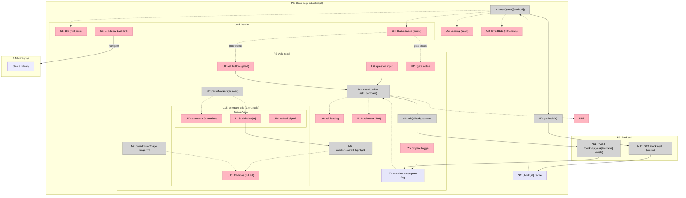

# Step 10: Ask — Breadboard (Shape A)

Detailing Shape A (`docs/v1/step10/shaping.md`) into concrete affordances. The
typed client (`request<T>` + `ApiError`), the `ask.ts`/`book.ts` zod schemas, and
the `<StatusBadge/>` + loading/error primitives **already exist** (Steps 8–9) —
they appear here as existing affordances the new pieces wire into. New
affordances: `getBook()`/`ask()` in `api/books.ts`, the `/books/{id}` client
page, `<AskPanel/>`, `<AnswerView/>` (with marker parsing), `<Citations/>`, and
the marker→citation scroll/highlight wiring.

## Places

| # | Place | Description |
|---|-------|-------------|
| P1 | Book page (`/books/[id]`) — frontend | `app/books/[id]/page.tsx`, now the real book page (was the Step 8 placeholder) |
| P2 | Ask panel — frontend | `<AskPanel/>` + `<AnswerView/>` + `<Citations/>` components hosted by P1 |
| P3 | Backend | FastAPI `GET /books/{id}` and `POST /books/{id}/ask` |
| P4 | Library (`/`) — frontend | Existing Step 9 Library; the "← Library" back-link target |

## UI Affordances

| # | Place | Component | Affordance | Control | Wires Out | Returns To |
|---|-------|-----------|------------|---------|-----------|------------|
| U1 | P1 | `app/books/[id]/page.tsx` | `<Loading/>` (book fetch) *(exists)* | render | — | — |
| U2 | P1 | `app/books/[id]/page.tsx` | `<ErrorState detail/>` (404 / backend down) *(exists)* | render | — | — |
| U3 | P1 | book header | title (null-safe) | render | — | — |
| U4 | P1 | book header | `<StatusBadge status/>` *(exists)* | render | — | — |
| U5 | P1 | book header | "← Library" back-link | click | → P4 | — |
| U6 | P2 | `AskPanel` | question `<input>` | type/submit | → N3 | — |
| U7 | P2 | `AskPanel` | "compare with plain LLM" toggle | toggle | → S2 | — |
| U8 | P2 | `AskPanel` | **Ask** button (disabled unless `ready` + non-empty) | click | → N3 | — |
| U9 | P2 | `AskPanel` | ask in-flight (loading) state | render | — | — |
| U10 | P2 | `AskPanel` | ask error state (incl. `409`) | render | — | — |
| U11 | P2 | `AskPanel` | gate notice (when `status !== 'ready'`) | render | — | — |
| U12 | P2 | `AnswerView` | answer text w/ inline `[n]` markers | render | → U13 | — |
| U13 | P2 | `AnswerView` | clickable `[n]` marker | click | → N6 | — |
| U14 | P2 | `AnswerView` | refusal signal (when `refused`) | render | — | — |
| U15 | P2 | (compare grid) | side-by-side columns: "with retrieval" / "without retrieval" | render | — | — |
| U16 | P2 | `Citations` | citation item: marker, `section_path` breadcrumb, page range, score, full `text` | render | — | ← N6 |

## Code Affordances

| # | Place | Component | Affordance | Control | Wires Out | Returns To |
|---|-------|-----------|------------|---------|-----------|------------|
| N1 | P1 | `app/books/[id]/page.tsx` | `useQuery(['book', id], () => getBook(id))` | observe | → N2 | → U1, U2, U3, U4 |
| N2 | P1 | `api/books.ts` | `getBook(id)` → `request('/books/'+id, BookOut)` | call | → N10 | → N1 |
| N3 | P2 | `AskPanel` | `useMutation` — `ask(id,{query,k:5},true)` always; `+ ask(id,{query,k:5},false)` when compare on (`Promise.all`) | observe | → N4 | → U9, U10, U12, U16 |
| N4 | P2 | `api/books.ts` | `ask(id, body, retrieve)` → `request('/books/'+id+'/ask'+(retrieve?'':'?retrieve=false'), AskResponse, {method:'POST', body})` | call | → N11 | → N3 |
| N5 | P2 | `AnswerView` | `parseMarkers(answer)` — split on `[n]` tokens → text + clickable markers | call | — | → U12, U13 |
| N6 | P2 | `AskPanel`/`AnswerView` | marker→citation **scroll + highlight** (`ref`/`scrollIntoView` + transient class) | call | — | → U16 |
| N7 | P2 | `lib/format` | page-range + breadcrumb (`section_path.join(' › ')`) formatting | call | — | → U16 |
| N10 | P3 | books router | `GET /books/{id}` → `BookOut` *(exists)* | call | → S1 | → N2 |
| N11 | P3 | books router | `POST /books/{id}/ask[?retrieve=false]` → `AskResponse` *(exists; `409` if not ready, `refused⇒citations=[]`)* | call | → S2 | → N4 |

## Data Stores

| # | Place | Store | Description |
|---|-------|-------|-------------|
| S1 | P1 | `['book', id]` query cache | TanStack Query cache for the single book; feeds header + gate. Refetch on mount/focus (D6), no polling |
| S2 | P2 | ask mutation state + compare flag | `useMutation` result (the RAG `AskResponse` + optional plain `AskResponse`) and the compare toggle (local component state); drives `<AnswerView/>`(s) |

## Wiring diagram

**Notes:**
- N10/N11 (backend) and `request<T>`/`ask.ts`/`book.ts`/`<StatusBadge/>` (the
  client + schemas + badge) are **existing** — Step 10 adds N2/N4 (two client
  fns), the `/books/{id}` render, and the P2 components.
- The **gate** is `U4`'s `status`: `U8` (Ask) is enabled only when
  `status === 'ready'`; otherwise `U11` explains why (mirrors backend `409` at
  N11, the belt-and-braces).
- **Compare** (U7→S2): off → N3 makes one call (`retrieve=true`), `U15` renders
  one column; on → N3 makes both calls, `U15` renders two (the plain column has
  no `U16` citations — `refused=false, citations=[]`).
- **Refusal** (U14): when the retrieval `AskResponse.refused` is true, `U12`
  still shows the answer text and `U14` signals the refusal; `U16` is empty
  (`citations=[]`).
- **Marker link** (U13→N6→U16): `N5` parses `[n]` into buttons; clicking one runs
  `N6` to scroll its `U16` citation into view + flash-highlight it.

## Next Step

Slice the breadboard into vertical increments (`slices.md`): V1 the working
single-answer Ask (gate + input + grounded answer + markers + citations +
refusal), V2 the compare toggle + side-by-side layout, V3 the `impeccable` pass —
each demoed against an API-seeded `ready` book.
