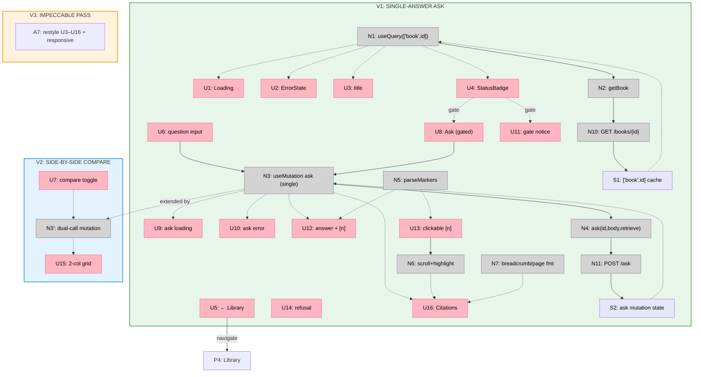

# Step 10: Ask — Slices (Shape A)

Slicing the Step 10 breadboard (`docs/v1/step10/breadboard.md`) into vertical
increments. The split is **core loop → comparison → polish**: V1 ships the
working single-answer Ask (gate + input + grounded answer + clickable markers +
full citations + refusal), V2 adds the opt-in side-by-side plain-LLM comparison
(the compare toggle + dual-call mutation + two-column layout), V3 is the
`impeccable` pass. Each is demoed against an API-seeded `ready` book.

V1 is the heart of the product on its own (a question gets a grounded, cited
answer). V2 is a clean addition — the compare toggle + a second call + a second
column — built without disturbing V1's render. V3 polishes both.

## Slice Summary

| # | Slice | Mechanism (shape parts) | Affordances | Demo |
|---|-------|--------------------------|-------------|------|
| V1 | Single-answer Ask | A1, A2, A3 (single call), A4, A5, A6 | U1–U6, U8–U14, U16, N1, N2, N3 (RAG only), N4, N5, N6, N7, N10, N11, S1, S2 | Seed a `ready` book; open `/books/{id}` → header (title + badge); ask a question → grounded answer with `[n]` markers + full citations below; click `[n]` → scrolls/highlights the source; ask something off-topic → refusal state; open a non-`ready` book → ask disabled w/ notice |
| V2 | Side-by-side compare | A3 (dual call), A4 (2-col) | U7, U15 (2-col), N3 (dual) | Toggle "compare with plain LLM" on → ask → two columns: "with retrieval" (answer + citations) and "without retrieval" (plain answer, no citations) render side by side; toggle off → single column as V1 |
| V3 | `impeccable` pass | A7 | (restyles U3–U16) | Before/after: header, input/toggle, answer typography + marker styling, compare grid, citation cards, refusal/loading/error states; desktop + narrow widths |

Max 9 slices; 3 used.

## V1: Single-answer Ask

Turns the placeholder `/books/{id}` into the real book page and ships the core
ask loop with **one** call (`retrieve=true`). The compare toggle (U7) and the
two-column layout (U15 split) are **not** in V1 — `<AnswerView/>` renders a
single retrieval column. Adds `getBook()`/`ask()` to `api/books.ts`, the client
page, `<AskPanel/>`, `<AnswerView/>` (with marker parse), `<Citations/>`, and the
marker→citation scroll/highlight.

| # | Place | Component | Affordance | Control | Wires Out | Returns To |
|---|-------|-----------|------------|---------|-----------|------------|
| U1 | P1 | page | `<Loading/>` (book fetch) *(exists)* | render | — | — |
| U2 | P1 | page | `<ErrorState/>` (404/down) *(exists)* | render | — | — |
| U3 | P1 | header | title (null-safe) | render | — | — |
| U4 | P1 | header | `<StatusBadge/>` *(exists)* | render | — | — |
| U5 | P1 | header | "← Library" back-link | click | → P4 | — |
| U6 | P2 | `AskPanel` | question input | type/submit | → N3 | — |
| U8 | P2 | `AskPanel` | Ask button (gated on `ready` + non-empty) | click | → N3 | — |
| U9 | P2 | `AskPanel` | ask loading | render | — | — |
| U10 | P2 | `AskPanel` | ask error (incl. `409`) | render | — | — |
| U11 | P2 | `AskPanel` | gate notice (`status !== 'ready'`) | render | — | — |
| U12 | P2 | `AnswerView` | answer text w/ `[n]` markers | render | → U13 | — |
| U13 | P2 | `AnswerView` | clickable `[n]` marker | click | → N6 | — |
| U14 | P2 | `AnswerView` | refusal signal | render | — | — |
| U16 | P2 | `Citations` | citation item (marker, breadcrumb, page range, score, full text) | render | — | ← N6 |
| N1 | P1 | page | `useQuery(['book',id], getBook)` | observe | → N2 | → U1,U2,U3,U4 |
| N2 | P1 | `api/books.ts` | `getBook(id)` → `request('/books/'+id, BookOut)` | call | → N10 | → N1 |
| N3 | P2 | `AskPanel` | `useMutation` — `ask(id,{query,k:5},true)` (single call) | observe | → N4 | → U9,U10,U12,U16 |
| N4 | P2 | `api/books.ts` | `ask(id, body, retrieve)` → `request('…/ask'+(retrieve?'':'?retrieve=false'), AskResponse, POST)` | call | → N11 | → N3 |
| N5 | P2 | `AnswerView` | `parseMarkers(answer)` → text + markers | call | — | → U12,U13 |
| N6 | P2 | `AnswerView` | marker→citation scroll + highlight | call | — | → U16 |
| N7 | P2 | `lib/format` | breadcrumb (`section_path.join(' › ')`) + page-range fmt | call | — | → U16 |
| N10 | P3 | books router | `GET /books/{id}` → `BookOut` *(exists)* | call | → S1 | → N2 |
| N11 | P3 | books router | `POST /books/{id}/ask` → `AskResponse` *(exists)* | call | → S2 | → N4 |
| S1 | P1 | — | `['book',id]` query cache | store | — | → N1 |
| S2 | P2 | — | ask mutation state | store | — | → N3 |

**Demo:** `make db-up && make db-migrate && make api-dev`; seed a book via
`POST /books/upload` and let it reach `ready` (or seed via the API); `make web`;
open `/` → click the card → `/books/{id}` shows the title + `ready` badge; type a
question → grounded answer renders with inline `[1][2]` markers and a full
citations list (breadcrumb, page range, score, text) below; click `[2]` → scrolls
to + flashes citation 2; ask an off-topic question → refusal signal + answer text,
no citations; open a `pending`/`processing` book → Ask disabled with the gate
notice; stop the API mid-ask → ask error state.

## V2: Side-by-side compare

Adds the opt-in comparison **without touching V1's single-column path**. New: the
compare toggle (U7), the dual-call mutation (N3 fires `ask(…,false)` too when on),
and the two-column layout (U15 wraps two `<AnswerView/>`s — the plain column has
no `<Citations/>`).

| # | Place | Component | Affordance | Control | Wires Out | Returns To |
|---|-------|-----------|------------|---------|-----------|------------|
| U7 | P2 | `AskPanel` | "compare with plain LLM" toggle | toggle | → S2 | — |
| U15 | P2 | compare grid | side-by-side columns: "with retrieval" / "without retrieval" | render | — | — |
| N3′ | P2 | `AskPanel` | `useMutation` — RAG call always; **+ `ask(id,{query,k:5},false)` when compare on** (`Promise.all`) | observe | → N4 | → U15 |
| S2′ | P2 | — | mutation state (RAG + optional plain `AskResponse`) + compare flag | store | — | → N3 |

**Demo:** on a `ready` book, turn the compare toggle **on** → ask → two columns
render: left "with retrieval" (answer + `[n]` markers + citations), right "without
retrieval" (plain-LLM answer, no citations, `refused=false`); turn it **off** →
ask → single column exactly as V1. Confirm only one network call fires when off,
two when on.

## V3: `impeccable` pass

No new affordances — restyles V1+V2's UI (U3–U16) and layout: the header, the
input + compare toggle affordance, answer typography + `[n]` marker styling, the
side-by-side compare grid (and its responsive collapse to stacked on narrow), the
citation cards (breadcrumb/page/score/text legibility — "citations are the
product"), and the refusal + loading + error states.

**Demo:** before/after of the Ask experience at desktop and narrow widths,
including the refusal state and the two-column compare.

## Slice diagram

## Next Step

Write `V1-plan.md` (the single-answer Ask implementation plan). V2 (compare) and
V3 (`impeccable`) get their plans when V1 lands — V2 extends V1's mutation +
render, V3 is a styling cycle on top of both.
