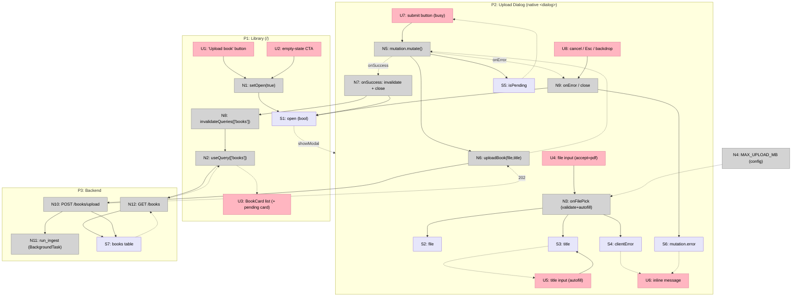

# Step 11: Upload — Breadboard (Shape A)

Detailing **Shape A** (entry point + native-`<dialog>` upload modal over the
library) from `shaping.md` into concrete affordances + wiring. Three Places: the
existing **Library** (modified — entry point added), the new **Upload Dialog**
modal, and the **Backend** `POST /books/upload`.

Affordance tables are the source of truth; the Mermaid renders them.

## Places

| # | Place | Description |
|---|-------|-------------|
| P1 | Library (`/`) — frontend | Existing `app/page.tsx`; gains the upload entry point + holds the dialog `open` state. Hosts the pending card after success |
| P2 | Upload Dialog — frontend | **New** modal: native `<dialog>` (`showModal()` ⇒ focus-trap/Esc/backdrop). The form + mutation live here |
| P3 | Backend | `POST /books/upload` handler + `books` table + the `GET /books` the library refetches |

## UI Affordances

| # | Place | Component | Affordance | Control | Wires Out | Returns To |
|---|-------|-----------|------------|---------|-----------|------------|
| U1 | P1 | `app/page.tsx` (header) | "Upload book" button | click | → N1 | — |
| U2 | P1 | `Empty` (CTA) | "Upload book" empty-state CTA | click | → N1 | — |
| U3 | P1 | book list `<ul>` | `<BookCard/>` list (incl. new **pending** card + `<StatusBadge status="pending"/>`) | render | → P2 (existing card link, untouched) | — |
| U4 | P2 | `UploadDialog` | file `<input type="file" accept="application/pdf">` | change (pick) | → N3 | — |
| U5 | P2 | `UploadDialog` | title `<Input>` (auto-filled from filename, editable) | type | → S3 | — |
| U6 | P2 | `UploadDialog` | inline message (`Notice`/`ErrorState`): client guard **or** server `ApiError` | render | — | — |
| U7 | P2 | `UploadDialog` | submit `<Button>` (busy/disabled while in-flight or invalid) | click | → N5 | — |
| U8 | P2 | `UploadDialog` | Cancel / close (button + Esc + backdrop) | click | → N9 | — |

## Code Affordances

| # | Place | Component | Affordance | Control | Wires Out | Returns To |
|---|-------|-----------|------------|---------|-----------|------------|
| N1 | P1 | `app/page.tsx` | `setOpen(true)` | call | → S1 | — |
| N2 | P1 | `api/books.ts` + page | `useQuery(['books'], listBooks)` | call | → N12 | → U3 |
| N3 | P2 | `UploadDialog` | `onFilePick(file)` — reject non-PDF; reject size > `MAX_UPLOAD_MB`; else set file + auto-fill title from filename | call | → S2, → S3, → S4 | — |
| N4 | — | `lib/config.ts` | `MAX_UPLOAD_MB` constant (default 100; opt. `NEXT_PUBLIC_MAX_UPLOAD_MB`) | config | — | → N3 |
| N5 | P2 | `UploadDialog` | `mutation.mutate()` (TanStack `useMutation`) | call | → N6 | — |
| N6 | P2 | `api/books.ts` | `uploadBook(file, title)` — build `FormData` → `request('/books/upload', UploadResponse, {method:'POST', body})` | call | → N10 | → N5 |
| N7 | P2 | `UploadDialog` | mutation `onSuccess` — `invalidateQueries(['books'])` + `setOpen(false)` | call | → N8, → S1 | — |
| N8 | P1 | `providers` | `queryClient.invalidateQueries(['books'])` | call | → N2 | — |
| N9 | P2 | `UploadDialog` | mutation `onError` → write friendly `ApiError` message; close handler → `setOpen(false)` | call | → S6, → S1 | — |
| N10 | P3 | `routers/books.py` | `POST /books/upload` — 422 (not pdf / empty title), 413 (over cap), insert+**commit** `books` row `pending`, schedule ingest, return `202 {book_id, status}` | call | → S7, → N11 | → N6 |
| N11 | P3 | `services/ingest.py` | `run_ingest` BackgroundTask (out of scope — Step 12 watches it) | call | — | — |
| N12 | P3 | `routers/books.py` | `GET /books` (newest-first) | call | → S7 (read) | → N2 |

## Data Stores

| # | Place | Store | Description |
|---|-------|-------|-------------|
| S1 | P1 | `open` (boolean) | Dialog open/closed; `setOpen` from N1 (open) / N7 / N9 (close). Read by P2 to `showModal()`/`close()` |
| S2 | P2 | `file` (File \| null) | Selected PDF; written by N3, read by N6 |
| S3 | P2 | `title` (string) | Auto-filled by N3, editable via U5; read by N6 |
| S4 | P2 | `clientError` (string \| null) | Client guard message (non-PDF / oversize); written by N3 → U6 |
| S5 | P2 | `mutation.isPending` | TanStack in-flight flag → busy/disabled U7 |
| S6 | P2 | `mutation.error` (ApiError) | Server error (413/422/fallback) friendly message → U6 |
| S7 | P3 | `books` table | Row inserted+committed at `pending` by N10 (before 202); read by N12 (`GET /books`) on the refetch |

## Wiring

## Verification

- **Every U displays/acts with a source.** U3 ← N2 (books query); U5 ← S3
  (autofill) + own typing; U6 ← S4 (client) / S6 (server); U7 busy ← S5. U1/U2/U4/U8
  are pure inputs.
- **Every N connects.** N1→S1; N2→N12/→U3; N3→S2/S3/S4; N5→N6 (+S5, onSuccess/onError);
  N6→N10; N7→N8/S1; N8→N2; N9→S6/S1; N10→S7/N11; N12→S7→N2.
- **Every S is read.** S1 (dialog showModal/close), S2/S3 (N6), S4/S6 (U6), S5 (U7),
  S7 (N12).
- **No fabricated optimistic row** (D2): the pending card flows S7 → N12 → N2 → U3,
  i.e. a real refetch of the committed row — there is no write into the `['books']`
  cache from the `202` body.
- **Navigation mechanisms omitted** as affordances: `showModal()`/`close()` are the
  native-`<dialog>` "how" of entering/leaving P2 — modelled as the `S1` open store
  driving the Place, not as standalone N's.

## Proposed slices (full breakdown → `slices.md`)

| # | Slice | Parts | Affordances | Demo |
|---|-------|-------|-------------|------|
| V1 | **Working upload (happy path)** | A1, A2, A3(core), A5 | U1, U2, U4, U5(autofill), U7, U3; N1, N3(autofill only), N5, N6, N7, N8, N2, N10, N12; S1, S2, S3, S7 | Click "Upload book" → pick a PDF → title auto-fills → submit → dialog closes → **pending card appears in `/`** |
| V2 | **Guards + error handling** | A4, A3(errors) | U6, U8; N4, N9, N3(validation branch); S4, S5, S6 | Pick a non-PDF / oversized file → inline client error, submit blocked; force a backend 413/422 → inline server message; submit shows busy state; Esc/backdrop closes |
| V3 | **`impeccable` pass** | A6 | (no new affordances — polish over V1+V2) | The finished, polished upload experience: entry-point buttons, dialog layout, file-picker affordance, title field, busy + inline-error states, empty-state CTA |

V1 carries Wires Out to V2 affordances (e.g. U7's busy state reads `S5`, errors
flow to `U6`) that are stubbed/no-op until V2 — normal per the slicing rules.
"Error handling" is pulled into its own V2 because the step name calls it out as a
first-class concern.

## Next Step

Write `slices.md` (per-slice affordance tables + demo statements) from the V1–V3
proposal above, then the `V1-plan.md` implementation plan. No flagged unknowns —
all affordances are ordinary client work over the existing `request<T>` /
`UploadResponse` / `<BookCard/>` / primitives + the unchanged backend.
