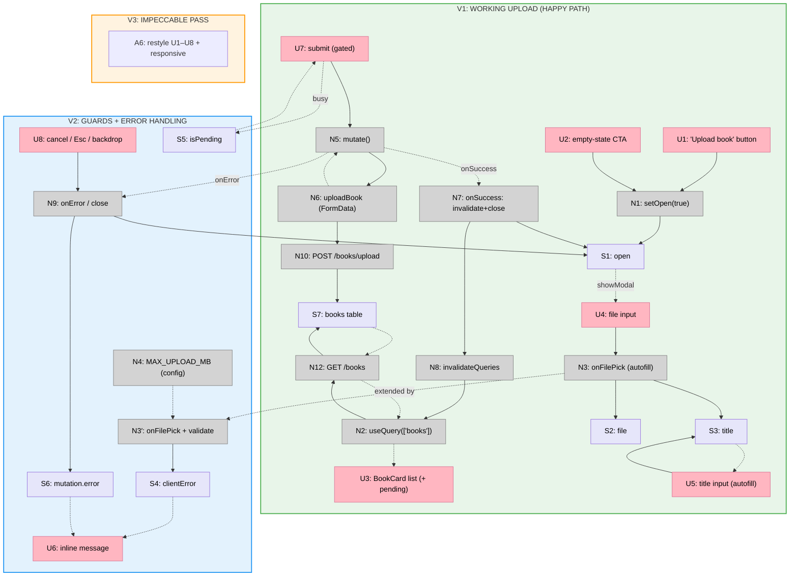

# Step 11: Upload — Slices (Shape A)

Slicing the Step 11 breadboard (`docs/v1/step11/breadboard.md`) into vertical
increments. The split is **happy path → guards/errors → polish**: V1 ships the
working upload (entry point → dialog → pick PDF → submit → pending card in `/`),
V2 adds the client guards + inline error handling + busy/close states, V3 is the
`impeccable` pass. Each is demoed against the running backend with a real PDF.

V1 is the core loop on its own (a PDF becomes a pending book without touching the
API). V2 is a clean addition over the same dialog — client-side validation, the
server-error surface, the in-flight state, and Esc/backdrop close — built without
disturbing V1's submit path. V3 polishes both. "Error handling" is its own slice
because the step name (`upload form, optimistic pending card, error handling`)
makes it a first-class concern.

## Slice Summary

| # | Slice | Mechanism (shape parts) | Affordances | Demo |
|---|-------|--------------------------|-------------|------|
| V1 | Working upload (happy path) | A1, A2, A3 (core), A5 | U1, U2, U3, U4, U5, U7, N1, N2, N3 (autofill only), N5, N6, N7, N8, N10, N12, S1, S2, S3, S7 | Click "Upload book" → dialog → pick a PDF → title auto-fills → submit → dialog closes → **pending card appears in `/`** |
| V2 | Guards + error handling | A4, A3 (errors) | U6, U8, N3 (validate branch), N4, N9, S4, S5, S6 | Pick a non-PDF / oversized file → inline client error, submit blocked; force a backend 413/422 → inline server message; submit shows busy; Esc / backdrop / Cancel closes |
| V3 | `impeccable` pass | A6 | (restyles U1–U8) | The polished upload experience: entry-point buttons, dialog layout, file-picker affordance, title field, busy + inline-error states, empty-state CTA |

Max 9 slices; 3 used.

## V1: Working upload (happy path)

Adds the upload entry point to the Library and ships the core loop: open the
dialog, pick a PDF (title auto-fills from the filename), submit, and on `202` the
real committed **pending** card appears in `/` via an `['books']` refetch — no
optimistic/fabricated row (D2). Adds `uploadBook()` to `api/books.ts`, the
`<UploadDialog/>` (native `<dialog>`), the entry-point button + empty-state CTA,
and the `open` state on `app/page.tsx`. The client guards (U6/N4), the server-error
surface (U6←S6), the busy state (S5), and the explicit close affordance (U8/N9)
are **not** in V1 — happy path only.

| # | Place | Component | Affordance | Control | Wires Out | Returns To |
|---|-------|-----------|------------|---------|-----------|------------|
| U1 | P1 | `app/page.tsx` (header) | "Upload book" button | click | → N1 | — |
| U2 | P1 | `Empty` | "Upload book" empty-state CTA | click | → N1 | — |
| U3 | P1 | book list `<ul>` | `<BookCard/>` list incl. new **pending** card + `<StatusBadge status="pending"/>` *(card exists)* | render | — | ← N2 |
| U4 | P2 | `UploadDialog` | file `<input type="file" accept="application/pdf">` | change (pick) | → N3 | — |
| U5 | P2 | `UploadDialog` | title `<Input>` (auto-filled from filename, editable) | type | → S3 | ← S3 |
| U7 | P2 | `UploadDialog` | submit `<Button>` (disabled until file + non-empty title) | click | → N5 | — |
| N1 | P1 | `app/page.tsx` | `setOpen(true)` | call | → S1 | — |
| N2 | P1 | page + `api/books.ts` | `useQuery(['books'], listBooks)` *(exists)* | observe | → N12 | → U3 |
| N3 | P2 | `UploadDialog` | `onFilePick(file)` — **set file + auto-fill title from filename** (no validation yet) | call | → S2, → S3 | — |
| N5 | P2 | `UploadDialog` | `mutation.mutate()` (`useMutation`) | call | → N6 | — |
| N6 | P2 | `api/books.ts` | `uploadBook(file, title)` — `FormData` → `request('/books/upload', UploadResponse, {method:'POST', body})` | call | → N10 | → N5 |
| N7 | P2 | `UploadDialog` | mutation `onSuccess` — `invalidateQueries(['books'])` + `setOpen(false)` | call | → N8, → S1 | — |
| N8 | P1 | providers | `queryClient.invalidateQueries(['books'])` | call | → N2 | — |
| N10 | P3 | books router | `POST /books/upload` → insert+commit `pending`, `202 {book_id,status}` *(exists)* | call | → S7 | → N6 |
| N12 | P3 | books router | `GET /books` (newest-first) *(exists)* | call | → S7 (read) | → N2 |
| S1 | P1 | — | `open` (boolean) dialog state | store | — | → P2 |
| S2 | P2 | — | `file` (File) | store | — | → N6 |
| S3 | P2 | — | `title` (string) | store | — | → N6, U5 |
| S7 | P3 | — | `books` table (committed `pending` row) | store | — | → N12 |

**Demo:** `make db-up && make db-migrate && make api-dev`; `make web`; open `/`
(empty → click the empty-state "Upload book" CTA; or non-empty → the header
button) → dialog opens; pick a real PDF → the title field auto-fills from the
filename (edit it if you like) → click Upload → dialog closes → a **pending**
`<BookCard/>` appears at the top of `/`; leave it and the backend ingest runs
(watching `pending`→`ready` live is Step 12 — refresh to see it flip for now).

## V2: Guards + error handling

Adds the safety + feedback layer over the same dialog **without changing V1's
submit path**. New: the client guards in `onFilePick` (reject non-PDF, reject size
> `MAX_UPLOAD_MB` before the `POST`), the `MAX_UPLOAD_MB` config constant, the
inline message surface (client *or* server `ApiError`), the in-flight busy state,
and the explicit close (Cancel button + Esc + backdrop).

| # | Place | Component | Affordance | Control | Wires Out | Returns To |
|---|-------|-----------|------------|---------|-----------|------------|
| U6 | P2 | `UploadDialog` | inline message (`Notice`/`ErrorState`): client guard **or** server error | render | — | ← S4, ← S6 |
| U8 | P2 | `UploadDialog` | Cancel / close (button + Esc + backdrop) | click | → N9 | — |
| N3′ | P2 | `UploadDialog` | `onFilePick` **+ validate**: reject non-PDF, reject size > `MAX_UPLOAD_MB` → write `clientError`; gate submit | call | → S2, → S3, → S4 | — |
| N4 | — | `lib/config.ts` | `MAX_UPLOAD_MB` constant (default 100; opt. `NEXT_PUBLIC_MAX_UPLOAD_MB`) | config | — | → N3′ |
| N9 | P2 | `UploadDialog` | mutation `onError` → write friendly `ApiError`; close handler → `setOpen(false)` | call | → S6, → S1 | — |
| S4 | P2 | — | `clientError` (string \| null) | store | — | → U6 |
| S5 | P2 | — | `mutation.isPending` | store | — | → U7 |
| S6 | P2 | — | `mutation.error` (ApiError friendly) | store | — | → U6 |

**Demo:** on the dialog, pick a `.txt` (or any non-PDF) → inline "must be a PDF",
submit disabled; pick a PDF over the cap → inline "too large", submit disabled,
**no** network call fires; pick a valid PDF and force a backend error (e.g. set
`MAX_UPLOAD_MB=0` server-side) → submit → busy state → inline `413` "That file is
too large." from the server; press Esc / click the backdrop / click Cancel → the
dialog closes without uploading.

## V3: `impeccable` pass

No new affordances — restyles V1+V2's UI (U1–U8) and the dialog chrome: the
entry-point button(s), the dialog layout + backdrop, the file-picker affordance
(a real "choose a PDF" target, not a raw `<input>`), the auto-filled title field,
the submit + busy state, the inline client/server message, and the empty-state
CTA. Responsive at narrow widths; consistent with the Library/Ask polish.

**Demo:** before/after of the upload experience at desktop and narrow widths,
including the empty-state CTA, a guard error, and the busy/submit state.

## Slice diagram

## Next Step

Write `V1-plan.md` (the happy-path upload implementation plan). V2 (guards +
errors) and V3 (`impeccable`) get their plans when V1 lands — V2 extends the same
dialog with validation + the error/busy/close surface, V3 is a styling cycle on
top of both.
