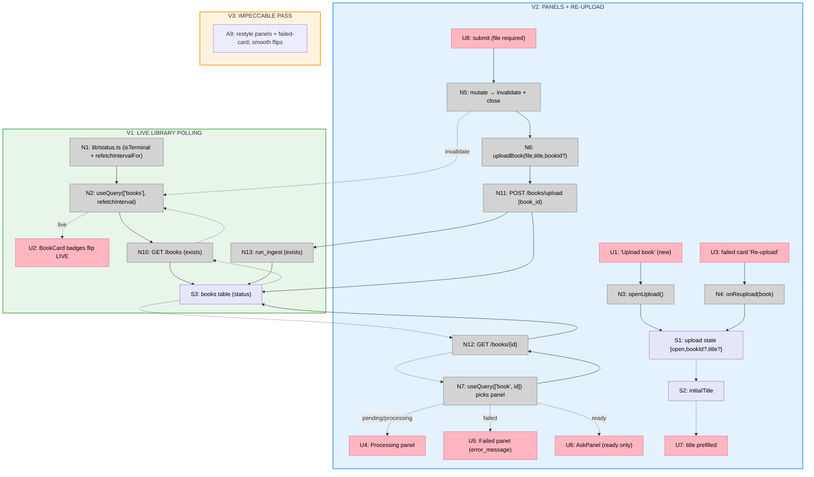

# Step 12: Status — Slices (Shape A)

Slicing the Step 12 breadboard (`docs/v1/step12/breadboard.md`) into vertical
increments. The split is **live polling → panels + re-upload → polish**: V1 ships
the shared `refetchInterval` so library badges flip live (completing Step 11's
deferred flip), V2 adds the book-page processing/failed panels plus the `failed`
library card's re-upload (the `book_id` arg, the dialog re-upload mode), V3 is the
`impeccable` pass. Each is demoed against the running backend with a real PDF.

V1 stands alone (a real upload reaches `ready` without a manual refresh — the most
visible gap from Step 11) and is the smallest possible slice: one new helper
module + one `refetchInterval` line, no new UI. V2 is the larger slice — the
book-page panels and the whole re-upload path — but builds cleanly on V1's poll:
a re-uploaded card visibly re-enters `pending` and marches to `ready` because V1
already polls. V3 polishes both.

## Slice Summary

| # | Slice | Mechanism (shape parts) | Affordances | Demo |
|---|-------|--------------------------|-------------|------|
| V1 | Live library polling | A1, A2 | U2; N1, N2, N10 *(exists)*, N13 *(exists)*, S3 | Upload a real PDF → its library card flips `pending→processing→ready` **live, no refresh**; polling self-stops once all cards are terminal |
| V2 | Processing/failed panels + re-upload | A3, A4, A5, A6, A7, A8 | U1, U3, U4, U5, U6, U7, U8; N3, N4, N5, N6, N7, N11 *(exists)*, N12 *(exists)*; S1, S2 | `processing` book → processing panel (Ask disabled); `failed` book page → read-only `error_message`; its **library card** offers **Re-upload** → prefilled dialog → pick PDF → submit → card flips back to `pending` and polls live |
| V3 | `impeccable` pass | A9 | (restyles V1+V2 surfaces) | Polished processing + failed panels, the failed-card re-upload affordance, and smooth (non-jarring) live badge transitions |

Max 9 slices; 3 used.

## V1: Live library polling

The smallest slice that closes Step 11's most visible gap (R8.2: a `pending` card
sat frozen until a manual refresh). Adds `lib/status.ts` — `isTerminal(status)`
plus `refetchIntervalFor(books, ms=2000)`, which returns `ms` while **any**
observed book is non-terminal and `false` once all are terminal — and feeds it to
`app/page.tsx`'s existing `['books']` `useQuery` via `refetchInterval`. No new UI:
the `<BookCard/>`/`<StatusBadge/>` already render every state, so badges flip in
place as the poll returns fresh rows. The book page stays un-polled (D1) — not
touched in V1.

| # | Place | Component | Affordance | Control | Wires Out | Returns To |
|---|-------|-----------|------------|---------|-----------|------------|
| U2 | P1 | book list `<ul>` | `<BookCard/>` badges **flip live** `pending→processing→ready/failed` *(card/badge exist)* | render | — | ← N2 |
| N1 | — | `lib/status.ts` | `isTerminal(status)` + `refetchIntervalFor(books, ms=2000)` — `ms` while any non-terminal, `false` when all terminal (D4/R1.1) | call | — | → N2 |
| N2 | P1 | `app/page.tsx` | `useQuery(['books'], listBooks)` **+ `refetchInterval: (q) => refetchIntervalFor(q.state.data)`** — the sole polling call site (D1/R1.2/R1.4) | observe | → N10 | → U2 |
| N10 | P4 | books router | `GET /books` (newest-first) *(exists)* | call | → S3 (read) | → N2 |
| N13 | P4 | `services/ingest.py` | `run_ingest` BackgroundTask — drives `books.status` *(exists; watched via the poll)* | call | → S3 | — |
| S3 | P4 | — | `books` table (status/error_message lifecycle) | store | — | → N10 |

**Demo:** `make db-up && make db-migrate && make api-dev`; `make web`; open `/` →
click "Upload book" → pick a real PDF → submit → the **pending** card appears, then
**flips to `processing` then `ready` with no manual refresh**. Open the network/React
Query devtools (or watch the request log): the `['books']` query refetches ~every
2s while the card is non-terminal and **stops** once it (and every other card) is
`ready`/`failed`.

## V2: Processing/failed panels + re-upload

The substance of the step. Two strands over V1's poll:

**Book-page panels (un-polled reader — D1/D5).** `app/books/[id]/page.tsx` keeps
its plain `['book', id]` query (fresh on mount, no `refetchInterval`) and **picks**
by `book.status`: `ready`→`<AskPanel/>` (unchanged), `pending`/`processing`→a new
**processing panel** ("we're parsing/embedding — Ask unlocks when ready", Ask not
rendered), `failed`→a new **failed panel** (read-only `error_message` + the
existing `← Library` link as the retry pointer; **no in-page re-upload** — D2).
These replace `AskPanel`'s terse non-ready notice; the Ask gate (mirrors backend
`409`) stays for `ready`.

**Library re-upload (sole entry — D2/D3).** `uploadBook(file, title, bookId?)`
appends `book_id` to the `FormData` only when present. `BookUploadDialog`/`Form`
gain a re-upload mode: an optional `bookId` + `initialTitle` (the form seeds its
default title from `initialTitle`; a PDF is still required, so submit stays gated
until one is picked). `app/page.tsx`'s upload state grows from `open: boolean` to
`{open, bookId?, title?}`; a `failed` `<BookCard/>` exposes a **Re-upload**
affordance that calls `onReupload(book)` to open the dialog seeded for that
`book_id`. On `202`, `onSuccess` invalidates `['books']` (+ `['book', bookId]`) →
the row re-enters `pending` → V1's policy resumes polling.

| # | Place | Component | Affordance | Control | Wires Out | Returns To |
|---|-------|-----------|------------|---------|-----------|------------|
| U1 | P1 | `app/page.tsx` (header) | "Upload book" — new-upload mode (no `bookId`) *(exists; now sets the richer state)* | click | → N3 | — |
| U3 | P1 | `<BookCard/>` (status=`failed`) | **"Re-upload"** affordance (sole entry — D2) | click | → N4 | — |
| U4 | P2 | book page | **Processing panel** (`pending`/`processing`): "parsing/embedding — Ask unlocks when ready"; Ask not rendered (D5/R2.1) | render | — | ← N7 |
| U5 | P2 | book page | **Failed panel** (`failed`): read-only `error_message` + `← Library` retry pointer; no in-page re-upload (D2/R3.1) | render | — | ← N7 |
| U6 | P2 | book page | `<AskPanel/>` — rendered **only** when `ready` *(exists)* | render | — | ← N7 |
| U7 | P3 | `BookUploadForm` | title `<Input>` **prefilled** from `initialTitle` in re-upload mode (editable; new-upload autofill unchanged) | render/type | — | ← S2 |
| U8 | P3 | `BookUploadDialog` | submit `<Button>` — file still required, so re-upload stays gated until a PDF is picked *(exists)* | click | → N5 | — |
| N3 | P1 | `app/page.tsx` | `openUpload()` → set `{open:true}` (no `bookId`) | call | → S1 | — |
| N4 | P1 | `app/page.tsx` ← `<BookCard onReupload/>` | `onReupload(book)` → set `{open:true, bookId:book.id, title:book.title}` (A8) | call | → S1 | — |
| N5 | P3 | `BookUploadDialog` | `mutate` → `onSuccess`: invalidate `['books']` (+ `['book', bookId]` when re-upload) + close (R4.2) | call | → N6, → N2 | — |
| N6 | P3 | `api/books.ts` | `uploadBook(file, title, bookId?)` — append `book_id` **only when present** (D3/R4.1) | call | → N11 | → N5 |
| N7 | P2 | `app/books/[id]/page.tsx` | `useQuery(['book', id], getBook)` un-polled; **picks** U4/U5/U6 by status (D1/R1.3) | observe | → N12 | → U4/U5/U6 |
| N11 | P4 | books router | `POST /books/upload` w/ optional `book_id` → upsert `pending`, clear `error_message`, re-schedule ingest *(exists)* | call | → S3, → N13 | → N6 |
| N12 | P4 | books router | `GET /books/{id}` → `BookOut` (status + error_message) *(exists)* | call | → S3 (read) | → N7 |
| S1 | P1 | — | upload state `{open, bookId?, title?}` (was a bare `open` boolean) | store | — | → P3, → S2 |
| S2 | P3 | — | `initialTitle` prop — seeds the form's default title (re-upload) | store | — | → U7 |

**Demo:** open a book mid-ingest → **processing panel** ("we're processing this…",
Ask input disabled). Force a `failed` book (e.g. upload a corrupt/garbage PDF, or
mark a row `failed` with an `error_message` in `make db-shell`) → its book page
shows the **read-only `error_message`** and points to `← Library`; **no re-upload
button there**. Back in `/`, the **failed card** shows a **Re-upload** action →
click → the dialog opens with the **title prefilled** and the `book_id` seeded →
pick the PDF again → submit → the card **flips back to `pending`** and (via V1's
poll) marches to `processing`→`ready` live. A *new* upload (header button) still
sends no `book_id` — Step 11 path unchanged.

## V3: `impeccable` pass

No new affordances — restyles V2's processing + failed panels and the failed-card
Re-upload affordance, and verifies the V1 live badge transitions read smoothly (no
jarring flip as a card swaps state on a poll). Consistent with the Library/Ask/
Upload polish from Steps 9–11. The pass refines these surfaces; it does not
introduce them (D5).

**Demo:** before/after of the processing panel, the failed panel (with a real
`error_message`), and the failed-card Re-upload affordance, at desktop and narrow
widths; plus a watch of a card flipping `pending→processing→ready` to confirm the
transition is smooth.

## Slice diagram

## Next Step

Write `V1-plan.md` (the live-polling implementation plan: `lib/status.ts` +
`app/page.tsx`'s `refetchInterval`). V2 (panels + re-upload) and V3 (`impeccable`)
get their plans when V1 lands — V2 adds the book-page panels and the whole
re-upload path (the `book_id` arg, the dialog mode, the failed-card affordance,
the richer upload state), V3 is a styling cycle over both.
