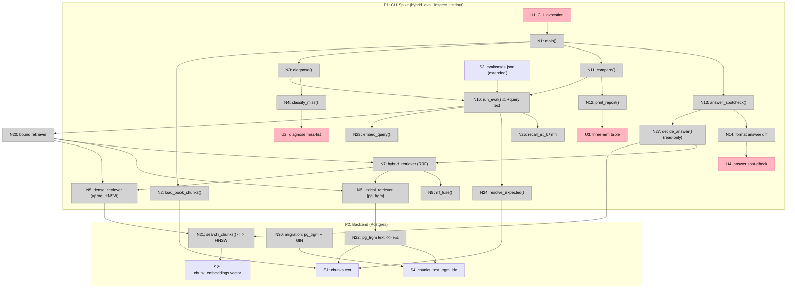

# Step 14: Hybrid Search Eval — Breadboard (Shape A)

Detailing **Shape A** (`docs/v1/step14/shaping.md`) into concrete affordances +
wiring. This is a **backend/CLI decision spike**, not a UI feature — so the
breadboard is almost all **Code (N)** affordances, with the only "UI" being the
driver-script invocation and its **stdout** report. The operator's journey:

> Run `scripts/hybrid_eval_inspect.py` against one ingested book → read the
> three-arm Recall@k / MRR table + per-case deltas → (V2) read the `/ask`
> answer spot-check → decide go/no-go on production hybrid.

**D3 resolved (breadboard decision): `pg_trgm`.** The lexical arm is trigram
similarity over `chunks.text` (`CREATE EXTENSION pg_trgm` — ships with Postgres
contrib, no Docker image rebuild; parser-free, handles CJK by char-trigrams; GIN
index `gin_trgm_ops`). Crude vs. a real segmenter, so it may *under*-estimate
lexical value — acceptable for a spike: a positive signal even with crude matching
is a strong "yes." R4.1 stratum **(vi) misspelled/near-form cases stays** (trigram
tolerates them).

## ⚠️ Key breadboard finding — the `Retriever` interface can't carry the query text

The existing harness types `Retriever = Callable[[list[float], int], list[int]]`
and `run_eval` calls it as `retriever(qv, k)` — it passes **only the embedded
vector**, computed internally via `embed_query(case["query"])`. **The dense arm is
fine** (it needs the vector). **But the lexical arm needs the raw query *string***
(`text <-> %s`), which `run_eval` never hands to the retriever. This is the one
real wiring gap A surfaces.

**Resolution (chosen): widen the interface by one argument.**
`Retriever = Callable[[list[float], str, int], list[int]]`; `run_eval`'s call site
becomes `retriever(qv, case["query"], k)` (a **one-line** change + the type alias).
Dense retrievers ignore the string; lexical/hybrid use it. This **amends R5.1's
"reuse `run_eval` unchanged"** to "reuse `run_eval` with a one-line signature
widening" — recorded honestly here (ripples to slices/plan).

(Considered and rejected: (a) a parallel `run_eval` copy in the script — duplicates
the scoring/OOS logic, drifts; (b) a stateful retriever that recovers text from a
qv→text map — fragile, abuses the closure. The one-line widening is cleanest.)

## Places

| # | Place | Description |
|---|-------|-------------|
| P1 | CLI Spike (`scripts/hybrid_eval_inspect.py` + stdout) | The operator's bounded context: run the command, read the printed reports. Standalone script path — `get_connection()`, never the pool |
| P2 | Backend (Postgres) | `chunks` / `chunk_embeddings`, the HNSW vector index, the **new** pg_trgm GIN index; the read surface for both retrieval arms |

## UI Affordances

| # | Place | Component | Affordance | Control | Wires Out | Returns To |
|---|-------|-----------|------------|---------|-----------|------------|
| U1 | P1 | hybrid_eval_inspect | CLI invocation `uv run python scripts/hybrid_eval_inspect.py [--book <id>] [--diagnose] [--answers]` | invoke | → N1 | — |
| U2 | P1 | stdout | **Diagnose** miss-list — per-case `hit`/`first_hit_rank` + a **lexical/semantic** tag (A1) | render | — | ← N4 |
| U3 | P1 | stdout | **Three-arm table** — Recall@k + MRR for dense / lexical / hybrid, plus per-case `top_k_indices` deltas (A5) | render | — | ← N12 |
| U4 | P1 | stdout | **Answer spot-check** — `/ask` output, current dense vs. hybrid context, on cases hybrid shifts (A6, V2) | render | — | ← N14 |

## Code Affordances

| # | Place | Component | Affordance | Control | Wires Out | Returns To |
|---|-------|-----------|------------|---------|-----------|------------|
| N1 | P1 | hybrid_eval_inspect | `main()` — `get_connection()`, pick `book_id`, load chunks + cases, build the three retrievers, dispatch on flags | call | → N2, → N3, → N5, → N6, → N7, → N11, → N13 | — |
| N2 | P1 | hybrid_eval_inspect | `load_book_chunks(conn, book_id)` — the `Chunk` list for `resolve_expected` + lexical scope | call | → S1 | → N1 |
| N3 | P1 | hybrid_eval_inspect | `diagnose()` — `run_eval(dense)`, then tag each miss (A1/R1.1); gate: lexical misses present ⇒ proceed, else stop | call | → N10, → N4 | → U2 |
| N4 | P1 | hybrid_eval_inspect | `classify_miss(case, result)` — lexical vs. semantic (hand/heuristic label) | call | — | → N3, → U2 |
| N5 | P1 | hybrid_eval_inspect | **`dense_retriever`** — adapts `search_chunks` (HNSW) to the `Retriever` sig; **= production** (A2/D2). Ignores the query-text arg | call | → N21 | → N10 |
| N6 | P1 | hybrid_eval_inspect | **`lexical_retriever`** — pg_trgm query (A3/D3); uses the **query-text** arg, ignores the vector | call | → N22 | → N10 |
| N7 | P1 | hybrid_eval_inspect | **`hybrid_retriever`** — calls dense + lexical, fuses via RRF (A4/D4) | call | → N5, → N6, → N8 | → N10 |
| N8 | P1 | hybrid_eval_inspect | `rrf_fuse(rankings, c=60, k)` — `Σ 1/(c+rank)`, no tunable weight (A4/D4) | call | — | → N7 |
| N10 | P1 | services.eval | **`run_eval(cases, chunks, retriever, k)`** — REUSED, ⚠️ **one-line widened** to `retriever(qv, case["query"], k)` (see finding) | call | → N20, → N23, → N24, → N25 | → N3, → N12 |
| N11 | P1 | hybrid_eval_inspect | `compare()` — `run_eval` × {dense, lexical, hybrid}, assemble means + per-case delta table (A5/R3.1) | call | → N10, → N26 | → U3 |
| N12 | P1 | services.eval | `print_report()` + per-case delta print (REUSED, extended formatting) | call | — | → U3 |
| N13 | P1 | hybrid_eval_inspect | `answer_spotcheck()` — on cases hybrid shifts, run `decide_answer` with dense vs. hybrid context (A6/R3.2, V2) | call | → N27 | → N14 |
| N14 | P1 | hybrid_eval_inspect | format the dense-vs-hybrid answer diff | call | — | → U4 |
| N20 | P1 | hybrid_eval_inspect | the bound `retriever` arg (one of N5/N6/N7, `partial`-bound to `conn`/`book_id`) | call | → N5 / N6 / N7 | → N10 |
| N21 | P2 | services.retrieval | `search_chunks(conn, book_id, qv, k)` — pgvector `<=>` over HNSW (REUSED, unchanged) | call | → S2 | → N5 |
| N22 | P2 | Postgres | **pg_trgm SQL** — `SELECT chunk_index ... WHERE book_id=%s ORDER BY text <-> %s LIMIT k` (NEW; `<->` = trigram distance) | call | → S1, → S4 | → N6 |
| N23 | P1 | services.embeddings | `embed_query(text)` — REUSED (called by `run_eval`, RETRIEVAL_QUERY, 1536-d L2-norm) | call | — | → N10 |
| N24 | P1 | services.eval | `resolve_expected(case, chunks)` — durable GT → `chunk_index`es (REUSED) | call | → S1 | → N10 |
| N25 | P1 | services.eval | `recall_at_k` / `mrr` (REUSED) | call | — | → N10 |
| N27 | P1 | services.generate | `decide_answer(...)` — READ-ONLY, for the answer gate (REUSED, unmodified) | call | → N21, → N7 | → N13 |
| N30 | P2 | alembic | **migration** — `CREATE EXTENSION IF NOT EXISTS pg_trgm` + `CREATE INDEX chunks_text_trgm_idx ON chunks USING gin (text gin_trgm_ops)` (NEW, A3/D3) | call | → S4 | — |

## Data Stores

| # | Place | Store | Description |
|---|-------|-------|-------------|
| S1 | P2 | `chunks` (`text`, `chunk_index`, `page_*`, `section_*`) | Read by the lexical arm (N22) and `resolve_expected` (N24) / `load_book_chunks` (N2) |
| S2 | P2 | `chunk_embeddings.vector(1536)` | Read by `search_chunks` (N21) via HNSW |
| S3 | P1 | `eval/cases.json` — **extended per R4.1** (6 strata, ~25–40 scored) | Read by `run_eval` (N10); the 11 existing cases are the semantic stratum |
| S4 | P2 | `chunks_text_trgm_idx` (GIN `gin_trgm_ops`) | Read by N22; created by N30 |

## Mermaid

## Verification

- **Every U has a source.** U2 ← N4 (diagnose tags); U3 ← N12 (`print_report`);
  U4 ← N14 (answer diff). U1 is the entry trigger.
- **Every N connects.** Retrievers (N5/N6/N7) return to `run_eval` (N10);
  helpers (N8/N23/N24/N25) return to their callers; the migration (N30) writes S4.
- **Two retrieval arms, two stores.** Dense reads S2 (HNSW); lexical reads S1 via
  S4 (trgm GIN). Hybrid (N7) fans into both, fuses in N8.
- **No production path touched.** `search_chunks` (N21) and `decide_answer` (N27)
  are read-only reuse; the only writes are the **new migration** (N30) and the
  **extended cases file** (S3). `run_eval`'s one-line widening (N10) is the sole
  edit to shipped code.

## Open questions / findings (ripples to slices + plan)

1. **`Retriever` interface widening** (⚠️ above) — `run_eval` + the type alias get a
   one-line change to pass `case["query"]`. **Amends R5.1.** Must be reflected in
   `slices.md` (lands in V1) and the V1 plan.
2. **pg_trgm operator choice** — ~~try `<->` first~~ **RESOLVED in V2-plan: use
   `word_similarity(query, text)`, not whole-string `<->`.** `<->` is whole-string
   trigram distance, so a short query vs. a long chunk scores ~0 (the chunk's many
   non-query trigrams dominate); `word_similarity` ranks by the query's best-matching
   substring — the right signal here. Primary: `ORDER BY word_similarity(%s, text)
   DESC`. (Note: GIN accelerates the boolean trgm ops, not KNN `ORDER BY`; fine at
   book scale — see finding #3.)
3. **Index granularity** — trgm GIN on `chunks.text` is global; the query is
   book-scoped (`WHERE book_id=%s`). Confirm the planner uses the GIN index under
   the book filter (mirrors the HNSW-naming lesson — verify via `EXPLAIN`). (Plan
   detail.)
4. **`k` for fusion vs. report** — fetch a deeper candidate list per arm (e.g. 20)
   before RRF, then truncate to the report `k` (=5). Pulling only top-5 per arm
   before fusing starves RRF. **Fetch wide, fuse, then cut to k.** (Plan detail.)

## Next Step

Slice Shape A. Expected (matching shaping's Next Step):
- **V1 — the spike** (demo-able: one command prints the three-arm Recall@k/MRR
  table + per-case deltas against a real book). Contains: N30 migration (pg_trgm +
  GIN), the `run_eval` one-line widening (N10), the extended cases (S3/R4.1), the
  three retrievers (N5/N6/N7) + `rrf_fuse` (N8), `diagnose()` (N3/N4), `compare()`
  (N11), and the driver scaffold (N1/N2). U1–U3.
- **V2 — answer gate + verdict** (demo-able: `--answers` prints dense-vs-hybrid
  `/ask` diffs on shifted cases; write the go/no-go). Contains: N13/N14/N27, U4.
