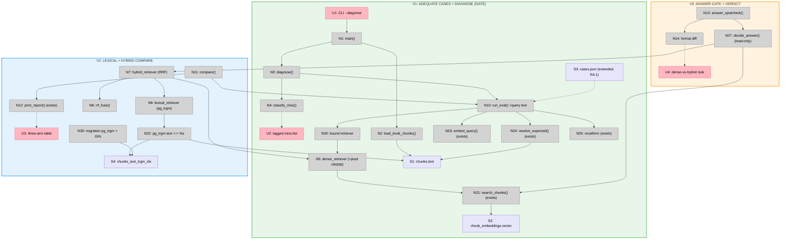

# Step 14: Hybrid Search Eval — Slices (Shape A)

Slicing the Step 14 breadboard (`docs/v1/step14/breadboard.md`) into vertical
increments. The split is **diagnose → compare → verdict**:

- **V1** builds an *adequate* eval set (R4.1's 6 strata) and the dense HNSW
  baseline, then runs the harness to find **where pure-dense misses** and tags each
  miss lexical vs. semantic. This is the **D1 stop/go gate**: if no miss is
  lexical-flavored, hybrid can't help — **stop here**, V2/V3 never get built.
- **V2** (only if V1 clears the gate) adds the pg_trgm lexical arm, the RRF hybrid
  arm, and the three-arm comparison table.
- **V3** runs the `/ask` answer gate on the cases hybrid shifts and writes the
  go/no-go verdict.

**This diverges from the breadboard's proposed V1** (which bundled the whole spike).
Slicing pulls **diagnose out as its own slice** precisely because D1 makes it a
*termination point* — the cheapest increment is also the one that can end the
project. Building lexical/hybrid before knowing dense even has lexical misses would
be speculative.

The output is a **decision**, not shipped retrieval (R6.1). The only edits to
shipped code are the one-line `run_eval` widening (V1) and the pg_trgm migration
(V2); `search_chunks` / `decide_answer` are read-only reuse throughout.

## Slice Summary

| # | Slice | Mechanism (shape parts) | Affordances | Demo |
|---|-------|--------------------------|-------------|------|
| V1 | Adequate eval set + diagnose (gate) | A1, A2 (+ R4.1, D2, D6) | U1, U2; N1, N2, N3, N4, N5, N10 *(widened)*, N20, N21 *(exists)*, N23/N24/N25 *(exist)*; S1, S2, S3 *(extended)* | One command runs the dense HNSW baseline over the extended case set → prints a per-case `hit`/`rank` miss-list **tagged lexical vs. semantic**. **Gate:** lexical misses present ⇒ proceed; none ⇒ record "hybrid not indicated" and stop |
| V2 | Lexical + hybrid three-arm comparison | A3, A4, A5 (+ D3=pg_trgm, D4=RRF) | U3; N6, N7, N8, N11, N12 *(exists, extended)*, N22, N30; S4 | `pg_trgm` migration applied; one command prints **dense / lexical / hybrid** Recall@k + MRR **plus per-case `top_k` deltas** over the same cases — read where hybrid wins/loses |
| V3 | Answer gate + verdict | A6 | U4; N13, N14, N27 *(exists)* | `--answers` prints **dense-vs-hybrid `/ask` output** on the cases hybrid shifts; write the go/no-go (ship / skip / needs-reranker-instead) |

Max 9 slices; 3 used.

## V1: Adequate eval set + diagnose (the gate)

The cheapest slice and the decision point. Two pieces of foundation, then the
diagnostic run:

**Adequate case set (R4.1/D6).** The current `eval/cases.json` (11 scored,
semantic-biased) **cannot** decide this — it has no query where lexical *should*
win. V1 extends it to ~25–40 scored cases across the 6 strata (rare proper nouns;
book-specific exact terms; numbers/equations/identifiers; exact-phrase quotes; CJK
exact terms; **misspelled/near-form** — kept since D3=pg_trgm tolerates them), each
with durable ground truth via the same `resolve_expected` contract (page-range
overlap + section substring). The existing 11 stay as the semantic stratum. Pick
**one** ingested, `ready` book to author against (its `chunks` are the GT surface).

**Dense baseline = production (A2/D2).** `dense_retriever` wraps `search_chunks`
(HNSW `<=>`), `partial`-bound to `(conn, book_id)`, conforming to the **widened**
`Retriever = Callable[[list[float], str, int], list[int]]` (it ignores the text
arg). This replaces `eval.py:retrieve()`'s brute-force `mat @ q` as the baseline so
the comparison reflects what ships. The one-line widening to `run_eval`'s call site
(`retriever(qv, case["query"], k)`) lands here so the signature is stable from the
start.

**Diagnose (A1/D1/R1.1).** Run `run_eval(dense)` over the extended set; for each
miss (`hit=False` or high `first_hit_rank`), hand/heuristic-tag **lexical** (exact
term / proper noun / number / quote / CJK term) vs. **semantic** (paraphrase /
reasoning). Print the tagged miss-list. **The gate.**

| # | Place | Component | Affordance | Control | Wires Out | Returns To |
|---|-------|-----------|------------|---------|-----------|------------|
| U1 | P1 | hybrid_eval_inspect | CLI `uv run python scripts/hybrid_eval_inspect.py --book <id> --diagnose` | invoke | → N1 | — |
| U2 | P1 | stdout | diagnose miss-list — per-case `hit`/`first_hit_rank` + **lexical/semantic** tag (A1) | render | — | ← N4 |
| N1 | P1 | hybrid_eval_inspect | `main()` — `get_connection()`, pick book, load chunks + cases, build dense retriever, dispatch `--diagnose` | call | → N2, → N3 | — |
| N2 | P1 | hybrid_eval_inspect | `load_book_chunks(conn, book_id)` → `Chunk` list (GT surface) | call | → S1 | → N1 |
| N3 | P1 | hybrid_eval_inspect | `diagnose()` — `run_eval(dense)` then collect misses | call | → N10, → N4 | → U2 |
| N4 | P1 | hybrid_eval_inspect | `classify_miss(case, result)` — lexical vs. semantic tag | call | — | → N3, → U2 |
| N5 | P1 | hybrid_eval_inspect | `dense_retriever` — adapts `search_chunks` (HNSW) to the widened sig; **= prod** (A2/D2) | call | → N21 | → N10 |
| N10 | P1 | services.eval | `run_eval(...)` — REUSED, **one-line widened** to pass `case["query"]` (breadboard finding; scoring/OOS untouched) | call | → N20, → N23, → N24, → N25 | → N3 |
| N20 | P1 | hybrid_eval_inspect | bound `retriever` arg (`partial(dense, conn, book_id)`) | call | → N5 | → N10 |
| N21 | P2 | services.retrieval | `search_chunks(conn, book_id, qv, k)` — HNSW *(exists, unchanged)* | call | → S2 | → N5 |
| N23 | P1 | services.embeddings | `embed_query(text)` *(exists)* | call | — | → N10 |
| N24 | P1 | services.eval | `resolve_expected(case, chunks)` *(exists)* | call | → S1 | → N10 |
| N25 | P1 | services.eval | `recall_at_k` / `mrr` *(exists)* | call | — | → N10 |
| S1 | P2 | — | `chunks` (`text`, `chunk_index`, `page_*`, `section_*`) | store | — | → N2, → N24 |
| S2 | P2 | — | `chunk_embeddings.vector(1536)` (HNSW) | store | — | → N21 |
| S3 | P1 | — | `eval/cases.json` — **extended to 6 strata** (R4.1); 11 existing = semantic stratum | store | — | → N10 |

**Demo:** `make db-up && make db-migrate`; ingest a real PDF, wait for `ready`;
extend `eval/cases.json` against it; `uv run python scripts/hybrid_eval_inspect.py
--book <id> --diagnose`. Output: a per-case table of dense `hit`/`rank` with a
**lexical/semantic tag** on each miss, and the gate verdict — *"N lexical misses →
proceed to V2"* or *"0 lexical misses → hybrid not indicated, stop."*

## V2: Lexical + hybrid three-arm comparison

Built **only if V1 clears the gate.** Adds the second and third arms and the
head-to-head table.

**pg_trgm lexical arm (A3/D3).** A migration (`uv run alembic revision`,
hand-written raw SQL per the repo convention): `CREATE EXTENSION IF NOT EXISTS
pg_trgm` + `CREATE INDEX chunks_text_trgm_idx ON chunks USING gin (text
gin_trgm_ops)`. `lexical_retriever` runs `SELECT chunk_index ... WHERE book_id=%s
ORDER BY text <-> %s LIMIT k` — it uses the **query-text** arg (the reason for the
widening), ignores the vector. `psycopg.sql` for any dynamic parts (no f-strings).

**RRF hybrid arm (A4/D4).** `hybrid_retriever` calls dense + lexical (each fetched
**wide**, e.g. top-20, per the breadboard's fusion-`k` finding), fuses via
`rrf_fuse(rankings, c=60, k)` = `Σ 1/(c+rank)`, truncates to the report `k`. No
tunable weight.

**Comparison (A5/R3.1).** `compare()` runs `run_eval` × {dense, lexical, hybrid}
over the same cases, assembles means + a per-case `top_k_indices` delta table via
an extended `print_report`. Per-case deltas matter more than the mean at this N.

| # | Place | Component | Affordance | Control | Wires Out | Returns To |
|---|-------|-----------|------------|---------|-----------|------------|
| U3 | P1 | stdout | three-arm table — Recall@k + MRR for dense/lexical/hybrid + per-case `top_k` deltas (A5) | render | — | ← N12 |
| N6 | P1 | hybrid_eval_inspect | `lexical_retriever` — pg_trgm `text <-> %s`, book-scoped, uses query-text arg (A3/D3) | call | → N22 | → N10 |
| N7 | P1 | hybrid_eval_inspect | `hybrid_retriever` — dense + lexical (fetch wide) → RRF (A4/D4) | call | → N5, → N6, → N8 | → N10 |
| N8 | P1 | hybrid_eval_inspect | `rrf_fuse(rankings, c=60, k)` — no tunable weight | call | — | → N7 |
| N11 | P1 | hybrid_eval_inspect | `compare()` — `run_eval` × {dense, lexical, hybrid}; means + per-case deltas | call | → N10, → N12 | → U3 |
| N12 | P1 | services.eval | `print_report()` + per-case delta print *(exists, extended formatting)* | call | — | → U3 |
| N22 | P2 | Postgres | pg_trgm query: `... WHERE book_id=%s ORDER BY text <-> %s LIMIT k` (NEW) | call | → S1, → S4 | → N6 |
| N30 | P2 | alembic | migration: `CREATE EXTENSION pg_trgm` + `CREATE INDEX ... gin (text gin_trgm_ops)` (NEW) | call | → S4 | — |
| S4 | P2 | — | `chunks_text_trgm_idx` (GIN `gin_trgm_ops`) | store | — | → N22 |

**Demo:** `make db-migrate` (applies the pg_trgm migration); `uv run python
scripts/hybrid_eval_inspect.py --book <id>`. Output: a table with **dense / lexical
/ hybrid** rows (mean Recall@5, MRR) and a per-case section showing each arm's
`top_k_indices` and where hybrid recovers a miss dense made. Sanity-check the GIN
index is used under the `book_id` filter via `EXPLAIN` (breadboard finding #3).

## V3: Answer gate + verdict

Closes the spike. A retrieval win only counts if it changes answers (D5).

**Answer spot-check (A6/R3.2).** For the cases where hybrid's retrieved set differs
from dense's (identified in V2), `answer_spotcheck()` calls `decide_answer`
(read-only) twice — once with dense context, once with hybrid — and prints the two
grounded answers side by side. Read whether the better retrieval actually changes
the answer.

**Verdict.** Write the go/no-go into `inspection-notes.md` (the dated hands-on doc):
**ship** (hybrid recovers real misses that change answers) / **skip** (retrieval
delta doesn't survive to the answer, or hybrid only wins on cases users don't ask)
/ **needs-reranker-instead** (misses are semantic, not lexical). Wiring hybrid into
`search_chunks` is a separate, conditional follow-up (R6.1).

| # | Place | Component | Affordance | Control | Wires Out | Returns To |
|---|-------|-----------|------------|---------|-----------|------------|
| U4 | P1 | stdout | answer spot-check — dense vs. hybrid `/ask` output on shifted cases (A6) | render | — | ← N14 |
| N13 | P1 | hybrid_eval_inspect | `answer_spotcheck()` — on shifted cases, `decide_answer` w/ dense vs. hybrid context | call | → N27 | → N14 |
| N14 | P1 | hybrid_eval_inspect | format the dense-vs-hybrid answer diff | call | — | → U4 |
| N27 | P1 | services.generate | `decide_answer(...)` — READ-ONLY *(exists, unmodified)* | call | → N21, → N7 | → N13 |

**Demo:** `uv run python scripts/hybrid_eval_inspect.py --book <id> --answers`.
Output: for each shifted case, the question + the dense-context answer + the
hybrid-context answer. Then the written verdict in `inspection-notes.md`.

## Slice diagram

## Next Step

Write `V1-plan.md` — the diagnose-gate implementation plan: extend
`eval/cases.json` (6 strata, ~25–40 scored, against one `ready` book), the
one-line `run_eval` widening, the `dense_retriever` wrapper over `search_chunks`,
and the `scripts/hybrid_eval_inspect.py --diagnose` driver (load chunks, run,
tag misses, print). V2 (pg_trgm + hybrid + compare) and V3 (answer gate + verdict)
get their plans **only if V1's gate clears** — building them before the gate would
be speculative (D1).
