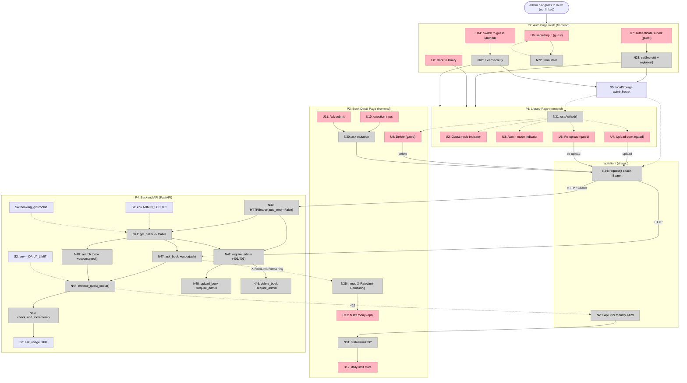

# Step 15 — Auth gate + guest mode — Breadboard

Details Shape **A** (`shaping.md`) into affordances + wiring across the two
systems (Next.js frontend + FastAPI backend). Admin gate uses FastAPI
**`HTTPBearer(auto_error=False)`** so `/docs` gets an Authorize button and the
missing-vs-wrong split (401 vs 403) stays ours to decide.

Parts → this breadboard: A1 admin gate (N40–N42, N45–N46), A2 identity seam
(N41), A3 FE auth (U2–U8, U14, N20–N24, S5), A4 guest cap (N43–N44, N47–N48,
S2–S4), A5 UI surfacing (N25, N31, U11–U12).

---

## Places

| # | Place | Description |
|---|-------|-------------|
| P1 | Library Page (frontend) | `app/page.tsx` — list + upload trigger + the app-shell "Guest mode" / admin indicator (header lives in `app/layout.tsx`, present on every route) |
| P2 | Auth Page (frontend) | NEW route `app/auth/page.tsx` (`/auth`) — secret input. **Not linked from any UI**; reached only by typing/bookmarking the URL. Guests never see a path to it |
| P3 | Book Detail Page (frontend) | `app/books/[id]/page.tsx` — AskPanel + delete; the 429 daily-limit surface |
| P4 | Backend API (FastAPI) | `api/auth.py` (new) + `services/rate_limit.py` (new) + `api/routers/books.py` |

**No visible auth affordance.** A normal user only ever sees a passive "Guest
mode" indicator. The admin reaches P2 by navigating to `/auth` directly (typed
URL / bookmark) — it's a real route but undiscoverable from the UI: nothing links
to it. The mode indicator sits in the shared header (layout), modeled under P1.
Replacing a route with a login system later is purely a P2 rewrite.

---

## UI Affordances

| # | Place | Component | Affordance | Control | Wires Out | Returns To |
|---|-------|-----------|------------|---------|-----------|------------|
| U2 | P1 | app header | "Guest mode" indicator (shown when **guest**) | render | — | ← N21 |
| U3 | P1 | app header | "Admin mode" indicator (shown when **authed**) — passive, no click | render | — | ← N21 |
| U4 | P1 | page | "Upload book" button (rendered only when **authed**) | click | → BookUploadDialog *(existing)* | — |
| U5 | P1 | BookCard | "Re-upload" action (rendered only when **authed**) | click | → BookUploadDialog *(existing)* | — |
| U6 | P2 | AuthForm | secret input (shown when **guest**) | type | → N22 | — |
| U7 | P2 | AuthForm | "Authenticate" submit (shown when **guest**) | click | → N23 | — |
| U14 | P2 | Auth Page | "Switch to guest mode" button (shown when **authed**) | click | → N20 | — |
| U8 | P2 | Auth Page | "Back to library" link | click | → P1 | — |
| U9 | P3 | detail header | "Delete" button (rendered only when **authed**) | click | → ConfirmDialog *(existing)* | — |
| U10 | P3 | AskPanel | question input | type | → N30 *(existing)* | — |
| U11 | P3 | AskPanel | "Ask" submit | click | → N30 *(existing)* | — |
| U12 | P3 | AskPanel | "daily limit reached — try again tomorrow" state | render | — | ← N31 |
| U13 | P3 | AskPanel | "N questions left today" *(optional)* | render | — | ← N25h |

Visibility of U3/U4/U5/U9 is driven by `useAuthed()` (N21); U2 ("Guest mode") is
its inverse. **P2 (`/auth`) is the only place mode is switched, both ways:** guest
sees the secret input (U6/U7); an already-authed admin sees "Switch to guest mode"
(U14) instead. The route is undiscoverable — no `<Link>` anywhere points to it.
The header (U2/U3) only *reports* the mode — it never toggles it. No search UI
exists in the frontend today, so the Search cap (N48) has **no FE surface** — it
is enforced backend-only.

---

## Code Affordances

| # | Place | Component | Affordance | Control | Wires Out | Returns To |
|---|-------|-----------|------------|---------|-----------|------------|
| N20 | P2 | `lib/session` | `clearSecret()` (back to guest) | call | → S5, → P1 | ← U14 |
| N21 | P1/P3 | `lib/session` | `useAuthed()` / `isAuthed()` | observe | — | → U2, U3, U4, U5, U9 |
| N22 | P2 | AuthForm | secret local field state | write | — | → U6 |
| N23 | P2 | Auth Page | `setSecret(s)` then `router.replace("/")` | call | → S5, → P1 | — |
| N24 | P1/P3 | `api/client:request()` | attach `Authorization: Bearer <secret>` when `isAuthed()` | call | → N41 *(over HTTP)* | ← S5 |
| N25 | P1/P3 | `api/client:ApiError.friendly` | add **429** → "daily limit reached" | call | — | → U11 |
| N25h | P3 | `api/books:ask` | read `X-RateLimit-Remaining` header *(optional)* | call | — | → U12 |
| N30 | P3 | AskPanel | ask mutation *(existing)* | call | → N24 → N47 | — |
| N31 | P3 | AskPanel | branch: `ApiError.status === 429` → limit state | conditional | → U11 | — |
| **N40** | P4 | `api/auth` | `bearer = HTTPBearer(auto_error=False)` security scheme | config | → N41, → N42 | — |
| **N41** | P4 | `api/auth` | `get_caller(req, resp, cred=Depends(N40), conn) -> Caller{is_admin, guest_id}` | call | → S1 *(read)*, → S4 *(read/mint Set-Cookie)* | → N42, → N44, → N47, → N48 |
| **N42** | P4 | `api/auth` | `require_admin(cred=Depends(N40), caller=Depends(N41))` — `cred is None`→**401**; `not is_admin`→**403** | call | — | → N45, → N46 |
| **N43** | P4 | `services/rate_limit` | `check_and_increment(conn, bucket, limit) -> Remaining` — `INSERT…ON CONFLICT (bucket,day) DO UPDATE count=count+1 RETURNING count` | call | → S3 | → N44 |
| **N44** | P4 | `services/rate_limit` | `enforce_guest_quota(conn, caller, kind)` — admin→no-op; else incr `guest:<id>:<kind>` **and** `global:<kind>`; global>limit→**429** + `X-RateLimit-Remaining` | call | → N43, → S2 *(read limit)* | → N47, → N48 |
| **N45** | P4 | `books.upload_book` | add `Depends(require_admin)` | call | ← N42 *(gates)* | — |
| **N46** | P4 | `books.delete_book` | add `Depends(require_admin)` | call | ← N42 *(gates)* | — |
| **N47** | P4 | `books.ask_book` | `caller=Depends(N41)`; call `enforce_guest_quota(conn, caller, "ask")` **before** `embed_query` **and before** the `retrieve=false` branch | call | → N44 | — |
| **N48** | P4 | `books.search_book` | `caller=Depends(N41)`; call `enforce_guest_quota(conn, caller, "search")` **before** `embed_query` | call | → N44 | — |

**Why N47 sits before the `retrieve=false` branch:** `?retrieve=false` →
`generate_plain_answer` still spends Gemini (R3 explicitly covers it). The quota
gate must precede *both* paths.

---

## Data Stores

| # | Place | Store | Description |
|---|-------|-------|-------------|
| S1 | P4 | env `ADMIN_SECRET` | the admin secret; const-time compared in N41. Never sent to client (R6) |
| S2 | P4 | env `ASK_DAILY_LIMIT` / `SEARCH_DAILY_LIMIT` | per-day global ceilings, read at call time by N44 |
| S3 | P4 | `ask_usage(bucket, day, count)` table | `global:<kind>` rows are **enforced**; `guest:<id>:<kind>` rows are **record-only**. Alembic migration, hand-written raw SQL |
| S4 | P4 | `bookrag_gid` cookie (browser) | anonymous guest id; minted + `Set-Cookie` (SameSite=Lax, long-lived) by N41 if absent. Feeds record buckets, **not** the enforced unit |
| S5 | frontend | `localStorage['bookrag.adminSecret']` | the secret the admin pasted; written by N20/N23, read by N24. The single FE credential store |

---

## Mermaid

---

## Slices

| # | Slice | Mechanism | Affordances | Demo |
|---|-------|-----------|-------------|------|
| V1 | Admin gate + `/auth` unlock | A1, A2 (is_admin), A3 | U2–U9, U14, N20–N24, N40–N42, N45–N46, S1, S5 | Guest sees only "Guest mode" (no auth link anywhere); visit `/auth` directly → paste secret → "Admin" + upload/delete appear and succeed; back at `/auth` → "Switch to guest mode" → read-only; wrong secret → write 403; `/docs` shows Authorize 🔒 on upload/delete |
| V2 | Guest daily cap | A2 (cookie), A4, A5 | N25, N31, U12, U13, N41(cookie), N43–N44, N47–N48, S2, S3, S4 | As guest, exhaust `ASK_DAILY_LIMIT` → next Ask renders "daily limit reached" (429, **no Gemini call**); admin unlimited; Search capped separately; `bookrag_gid` cookie set |

**V1 notes:** `get_caller` (N41) is introduced here for `require_admin`, computing
only `is_admin`. Cookie minting (S4) + `guest_id` land in V2. Read/search/ask
routes stay open in V1 — the cap is V2.

**V2 notes:** N44 increments the per-guest **record** bucket *and* the enforced
**global** bucket in one transaction; only the global row gates (R7 / C4-C).
N25h + U13 ("N left today") are **optional** — they require plumbing the
`X-RateLimit-Remaining` header out of `request()`, which today returns the
parsed body only. Ship the 429 state (must) first; add the count if cheap.

---

## `/docs` impact (the question that prompted HTTPBearer)

- N40 `HTTPBearer` emits an OpenAPI `http`/`bearer` security scheme → Swagger
  **Authorize** button; upload/delete show 🔒 and are callable after pasting the
  secret. Read/search/ask stay open (no scheme on them).
- N44's 429 is runtime only — no schema change. Optionally document a 429
  response on ask/search.
- `/docs` and `/openapi.json` themselves remain **public** — not gated by this
  shape. Closing them to guests is an open item, out of scope here.

---

## Verification checks

- Every gated write U (U4/U5/U9) → N24 → backend gate (N42). ✅
- P2 (`/auth`) is reachable **only** by direct navigation; no `<Link>` or rendered
  affordance points to it, so guests can't discover it. The secret travels via
  POST/header, never the URL (no history/log/referer leak). ✅
- Every display U has a source: U12 ← N31 (← N25 ← N44 429); U13 ← N25h. ✅
- N41 is the **only** identity-establishing affordance (R4 backend seam); N24 the
  **only** credential-attach point (R4 frontend seam). Swapping secret→login
  rewrites N41 + N24 bodies only — routers (N45–N48) and call sites untouched. ✅
- N47 quota precedes both the `embed_query` and `retrieve=false` paths (R3). ✅
- Admin bypass: N44 no-ops when `caller.is_admin` (R5). ✅
