# Step 5 Breadboard — FastAPI shell + background ingest

Details Shape B from [shaping.md](./shaping.md) into concrete affordances and
wiring. The "UI" is the HTTP surface — the API client's view of the four
endpoints (`POST /books/upload`, `GET /books`, `GET /books/:id`,
`GET /books/:id/chunks`) and their JSON / status-code responses. The Code
affordances are the handler chain, the background ingest orchestrator, and the
services it composes.

This breadboard reveals no new mechanisms beyond the B1–B8 parts already in
`shaping.md`. It only makes their wiring concrete.

## Workflow Guide

| Step  | Action                                                            | Where to look                                                 |
| ----- | ----------------------------------------------------------------- | ------------------------------------------------------------- |
| **0** | Operator runs `make db-migrate` once before first boot             | N60 → S1, S2, S3 (TRIGGER)                                    |
| **1** | Client uploads a PDF (`POST /books/upload`)                        | U1 → N10 → N11 → N12 → N13 → N14 → N15 → U5                   |
| **2** | FastAPI returns 202 + `book_id`; handler ends                      | N15 → U5                                                      |
| **3** | After response sent, BackgroundTasks runs the ingest               | N14 → N20 → N21                                                |
| **4** | Worker thread parses → chunks → embeds → stores                    | N21 → N22 → N23 → N24 → N25 → N26 → N27                        |
| **4f**| Any exception lands the book in `failed`                           | N21 → N28 → S1                                                |
| **5** | Client polls `GET /books/:id` for status                           | U3 → N41 → S1 → U6                                            |
| **6** | When status=`ready`, client reads chunks paginated                 | U4 → N42 → S1 → S2 → U8                                        |
| **L** | Or client lists all books                                          | U2 → N40 → S1 → U7                                            |

## Places

| #  | Place                       | Description                                                                                  |
| -- | --------------------------- | -------------------------------------------------------------------------------------------- |
| P1 | API Client                  | HTTP caller — curl, frontend, integration test. Sees the four endpoints + their responses.   |
| P2 | FastAPI process             | Request-handler execution context. Pool + DI + lifespan + sync handlers run on the event loop. |
| P3 | Background ingest worker    | Same Python process, **separate thread** (`anyio.to_thread.run_sync`). Owns the sync pipeline. |

**TRIGGER: `make db-migrate`** — operator-initiated, not runtime. Applies the
three Alembic revisions against the configured `DATABASE_URL`.

## Data Stores

| #  | Store                        | Description                                                                                            |
| -- | ---------------------------- | ------------------------------------------------------------------------------------------------------ |
| S1 | `books` table                | id, title, file_path, created_at, **status** (enum), **error_message** (added by Alembic revs ≥0003)   |
| S2 | `chunks` table               | id, book_id, chunk_index, text, page_start/end, section_path/title/level, created_at                   |
| S3 | `chunk_embeddings` table     | chunk_id, embedding `vector(1536)`, embedding_model. CASCADE-deletes when its `chunks` row is removed. |
| S4 | `UPLOAD_DIR` filesystem      | `{UPLOAD_DIR}/{book_id}.pdf` — one file per book, overwritten on re-ingest                             |

Stores live "above" both P2 (writes on upload + reads for GETs) and P3 (writes
during ingest), so they sit at the top of the model rather than inside one place.

## UI Affordances (P1 — API Client)

| #  | Place | Component  | Affordance                                                          | Control | Wires Out | Returns To |
| -- | ----- | ---------- | ------------------------------------------------------------------- | ------- | --------- | ---------- |
| U1 | P1    | curl/client | `POST /books/upload` (multipart PDF + `title` [+ optional `book_id`]) | call    | → N10     | —          |
| U2 | P1    | curl/client | `GET /books`                                                        | call    | → N40     | —          |
| U3 | P1    | curl/client | `GET /books/:id`                                                    | call    | → N41     | —          |
| U4 | P1    | curl/client | `GET /books/:id/chunks?limit=&offset=`                              | call    | → N42     | —          |
| U5 | P1    | curl/client | `202 Accepted` `{book_id, status:"pending"}`                        | render  | —         | —          |
| U6 | P1    | curl/client | `200 BookOut` JSON (id, title, file_path, created_at, status, error_message?) | render  | —         | —          |
| U7 | P1    | curl/client | `200 BookList` JSON (list of `BookOut`)                             | render  | —         | —          |
| U8 | P1    | curl/client | `200 ChunkPage` JSON (`items`, `total`, `limit`, `offset`)          | render  | —         | —          |
| U9 | P1    | curl/client | `4xx` error (`404 unknown id` / `409 not ready` later / `422 invalid input`) | render  | —         | —          |

## Code Affordances

### P2 — Upload chain (`api/routers/books.py`)

| #   | Place | Component                | Affordance                                                                                   | Control | Wires Out                | Returns To |
| --- | ----- | ------------------------ | -------------------------------------------------------------------------------------------- | ------- | ------------------------ | ---------- |
| N10 | P2    | `api/routers/books.py`   | `validate_upload(file, title, book_id?)` — PDF content-type, non-empty title, ≤ `MAX_UPLOAD_MB` | call    | → N11, → U9 (422 path)   | —          |
| N11 | P2    | `api/routers/books.py`   | `resolve_book_id(book_id?)` — if given, `SELECT 1 FROM books WHERE id=?`; missing → 404; absent → new uuid4 | call    | → N12, → U9 (404 path)   | —          |
| N12 | P2    | `api/routers/books.py`   | `persist_pdf(book_id, file)` — write `{UPLOAD_DIR}/{book_id}.pdf`                            | call    | → S4, → N13              | —          |
| N13 | P2    | `api/routers/books.py`   | `upsert_books_row(book_id, title, file_path)` — `INSERT … ON CONFLICT (id) DO UPDATE SET title=…, file_path=…, status='pending', error_message=NULL` | call    | → S1, → N14              | —          |
| N14 | P2    | `api/routers/books.py`   | `BackgroundTasks.add_task(run_ingest, book_id, pdf_path, title)` — schedules N20 after response | call    | → N15, → N20 *(deferred)* | —          |
| N15 | P2    | `api/routers/books.py`   | `return UploadResponse(book_id, status='pending')` (HTTP 202)                                | call    | → U5                     | —          |

### P2 — Read handlers (`api/routers/books.py`)

| #   | Place | Component                | Affordance                                                                                   | Control | Wires Out | Returns To |
| --- | ----- | ------------------------ | -------------------------------------------------------------------------------------------- | ------- | --------- | ---------- |
| N40 | P2    | `api/routers/books.py`   | `list_books()` — `SELECT … FROM books ORDER BY created_at DESC`                              | call    | —         | → U7       |
| N41 | P2    | `api/routers/books.py`   | `get_book(book_id)` — `SELECT … WHERE id=?`; 404 if missing                                  | call    | → U9 (404 path) | → U6  |
| N42 | P2    | `api/routers/books.py`   | `get_chunks(book_id, limit, offset)` — validate book exists; `SELECT … FROM chunks WHERE book_id=? ORDER BY chunk_index LIMIT ? OFFSET ?` + `SELECT count(*) …` for `total` | call    | → U9 (404 path) | → U8 |

### P2 — Infra (`db/connection.py`, `api/deps.py`, `api/main.py`)

| #   | Place | Component             | Affordance                                                                              | Control | Wires Out                | Returns To           |
| --- | ----- | --------------------- | --------------------------------------------------------------------------------------- | ------- | ------------------------ | -------------------- |
| N50 | P2    | `db/connection.py`    | `get_pool() -> ConnectionPool` — lazy module-level `psycopg_pool.ConnectionPool` with `configure=register_vector` | call    | —                        | → N51, → N21 (via own pool acquisition) |
| N51 | P2    | `api/deps.py`         | `get_conn()` FastAPI dependency — `with get_pool().connection() as conn: yield conn`     | call    | —                        | → N11, → N13, → N40, → N41, → N42 |
| N52 | P2    | `api/main.py`         | `@asynccontextmanager lifespan(app)` — opens pool on startup, closes on shutdown; **does NOT** apply migrations | observe | → N50                    | —                    |

### P3 — Background ingest (`services/ingest.py`, `services/store.py`)

| #   | Place | Component             | Affordance                                                                                                       | Control | Wires Out                              | Returns To       |
| --- | ----- | --------------------- | ---------------------------------------------------------------------------------------------------------------- | ------- | -------------------------------------- | ---------------- |
| N20 | P2    | `services/ingest.py`  | `async run_ingest(book_id, pdf_path, title)` — async wrapper: `await anyio.to_thread.run_sync(ingest_pdf, …)` (event-loop boundary) | call    | → N21                                  | —                |
| N21 | P3    | `services/ingest.py`  | `ingest_pdf(book_id, pdf_path, title)` — sync orchestrator. Opens its own pooled conn. `try:` → N22 → N23 → N24 → N25 → N26 → N27; `except:` → N28 | call    | → N22, → N23, → N24, → N25, → N26, → N27, → N28 | —          |
| N22 | P3    | `services/ingest.py`  | `set_status('processing')` — `UPDATE books SET status='processing' WHERE id=?`                                   | call    | → S1                                   | —                |
| N23 | P3    | `services/pdf_parser.py` | `parse_pdf(pdf_path)` — `pymupdf.open` + text extraction (reuses Step 1)                                       | call    | —                                      | → N21 (`doc`)    |
| N24 | P3    | `services/chunker.py` | `chunk_pdf(doc)` — produces `list[Chunk]` (reuses Step 2)                                                       | call    | —                                      | → N21 (`chunks`) |
| N25 | P3    | `services/embeddings.py` | `embed_chunks(chunks)` — Gemini batched embed (reuses Step 3)                                                | call    | —                                      | → N21 (`embeddings`) |
| N26 | P3    | `services/store.py`   | `ingest_book(conn, book_id, chunks, embeddings, title, file_path)` — single transaction: `INSERT books … ON CONFLICT DO UPDATE`, then `DELETE FROM chunks WHERE book_id=?` (CASCADEs S3), then `INSERT chunks` + `INSERT chunk_embeddings` | call    | → S1, → S2, → S3                       | —                |
| N27 | P3    | `services/ingest.py`  | `set_status('ready')` — `UPDATE books SET status='ready' WHERE id=?` (success path)                              | call    | → S1                                   | —                |
| N28 | P3    | `services/ingest.py`  | `set_status('failed', error_message)` — fresh transaction; on **any** exception in N21–N26                       | call    | → S1                                   | —                |

### TRIGGER — DB migrate (`alembic/`)

| #   | Place    | Component | Affordance                                                                              | Control | Wires Out      | Returns To |
| --- | -------- | --------- | --------------------------------------------------------------------------------------- | ------- | -------------- | ---------- |
| N60 | TRIGGER  | `Makefile` → `alembic` | `make db-migrate` → `alembic upgrade head` — applies revisions `_init`, `_chunks_cascade`, `_book_status` | invoke  | → S1, → S2, → S3 | —          |

## Wiring Diagram

```mermaid
flowchart TB
    %% Step markers (workflow guide)
    step0(["0 - MIGRATE DB"])
    step1(["1 - POST /books/upload"])
    step2(["2 - 202 + book_id"])
    step3(["3 - BG TASK RUNS"])
    step4(["4 - INGEST PIPELINE"])
    step5(["5 - POLL STATUS"])
    step6(["6 - READ CHUNKS"])

    subgraph stores["DATA STORES"]
        S1["S1: books table"]
        S2["S2: chunks table"]
        S3["S3: chunk_embeddings table"]
        S4["S4: UPLOAD_DIR filesystem"]
    end

    subgraph trigger["TRIGGER: make db-migrate"]
        N60["N60: alembic upgrade head"]
    end

    subgraph P1["P1: API Client"]
        U1["U1: POST /books/upload"]
        U2["U2: GET /books"]
        U3["U3: GET /books/:id"]
        U4["U4: GET /books/:id/chunks"]
        U5["U5: 202 + book_id"]
        U6["U6: BookOut"]
        U7["U7: BookList"]
        U8["U8: ChunkPage"]
        U9["U9: 4xx error"]
    end

    subgraph P2["P2: FastAPI process"]
        subgraph upload["Upload chain"]
            N10["N10: validate_upload"]
            N11["N11: resolve_book_id"]
            N12["N12: persist_pdf"]
            N13["N13: upsert_books_row"]
            N14["N14: BackgroundTasks.add_task"]
            N15["N15: return 202"]
        end

        subgraph reads["Read handlers"]
            N40["N40: list_books"]
            N41["N41: get_book"]
            N42["N42: get_chunks"]
        end

        subgraph infra["Infra"]
            N50["N50: get_pool"]
            N51["N51: get_conn dep"]
            N52["N52: lifespan"]
        end

        N20["N20: run_ingest (async wrapper)"]
    end

    subgraph P3["P3: Background ingest worker (anyio thread)"]
        N21["N21: ingest_pdf"]
        N22["N22: set status=processing"]
        N23["N23: parse_pdf"]
        N24["N24: chunk_pdf"]
        N25["N25: embed_chunks"]
        N26["N26: ingest_book"]
        N27["N27: set status=ready"]
        N28["N28: set status=failed + err"]
    end

    %% Setup
    N60 --> S1
    N60 --> S2
    N60 --> S3

    %% Lifespan
    N52 --> N50
    N50 -.-> N51
    N51 -.-> N11
    N51 -.-> N13
    N51 -.-> N40
    N51 -.-> N41
    N51 -.-> N42

    %% Upload flow
    U1 --> N10
    N10 --> N11
    N10 -->|invalid| U9
    N11 -.-> S1
    S1 -.->|exists?| N11
    N11 -->|unknown id| U9
    N11 --> N12
    N12 --> S4
    N12 --> N13
    N13 --> S1
    N13 --> N14
    N14 --> N15
    N15 --> U5

    %% Background path
    N14 -.->|deferred after response| N20
    N20 -->|anyio.to_thread.run_sync| N21
    N21 --> N22
    N22 --> S1
    N21 --> N23
    N23 -.->|doc| N24
    N24 -.->|chunks| N25
    N25 -.->|embeddings| N26
    S4 -.->|pdf_path| N23
    N26 --> S1
    N26 --> S2
    N26 --> S3
    N21 -->|success| N27
    N21 -->|exception| N28
    N27 --> S1
    N28 --> S1

    %% Reads
    U2 --> N40
    N40 -.-> S1
    S1 -.-> N40
    N40 -.-> U7

    U3 --> N41
    N41 -.-> S1
    S1 -.-> N41
    N41 -.-> U6
    N41 -->|not found| U9

    U4 --> N42
    N42 -.-> S1
    N42 -.-> S2
    S1 -.-> N42
    S2 -.-> N42
    N42 -.-> U8
    N42 -->|not found| U9

    %% Step markers
    step0 -.-> N60
    step1 -.-> U1
    step2 -.-> U5
    step3 -.-> N20
    step4 -.-> N21
    step5 -.-> U3
    step6 -.-> U4

    classDef ui fill:#ffb6c1,stroke:#d87093,color:#000
    classDef nonui fill:#d3d3d3,stroke:#808080,color:#000
    classDef store fill:#e6e6fa,stroke:#9370db,color:#000
    classDef trig fill:#98fb98,stroke:#228b22,color:#000
    classDef step fill:#90EE90,stroke:#228B22,color:#000,font-weight:bold

    class U1,U2,U3,U4,U5,U6,U7,U8,U9 ui
    class N10,N11,N12,N13,N14,N15,N20,N21,N22,N23,N24,N25,N26,N27,N28,N40,N41,N42,N50,N51,N52 nonui
    class S1,S2,S3,S4 store
    class N60 trig
    class step0,step1,step2,step3,step4,step5,step6 step
```

## Shape Parts → Affordances

Coverage check — every B part from `shaping.md` has at least one affordance:

| B part | Affordances                          |
| ------ | ------------------------------------ |
| B1.1   | N52 (lifespan in `api/main.py`)      |
| B1.2   | N10–N15, N40–N42 (routes in `api/routers/books.py`) |
| B1.3   | N51 (`get_conn` Depends in `api/deps.py`) |
| B1.4   | U5, U6, U7, U8, U9 (Pydantic response shapes) |
| B2.1   | N50 (`get_pool` with `configure=register_vector`) |
| B2.2   | (out of breadboard scope — `get_connection` keeps scripts working; not exercised by FastAPI flows) |
| B3.1–B3.4 | N60 (alembic trigger creates/migrates S1, S2, S3) |
| B3.5   | N60 (no `init_db` exists; only N60 + N52) |
| B4.1, B4.2 | N26 (`ingest_book` in `services/store.py`) |
| B4.3   | (out of breadboard scope — script update; same `ingest_book` is reused) |
| B5.1, B5.3 | N21, N22, N27, N28 (sync orchestrator + status writes) |
| B5.2   | N20 (async wrapper) + N21 (sync body) — the event-loop / thread boundary |
| B6.1   | N10                                  |
| B6.2   | N11                                  |
| B6.3   | N12 (+ S4)                           |
| B6.4   | N13                                  |
| B6.5   | N14 → N20                            |
| B6.6   | N15 → U5                             |
| B7.1   | N40                                  |
| B7.2   | N41                                  |
| B7.3   | N42                                  |
| B8     | (config / env — not affordances)     |

## Verification

- **Every U with data has a source.** U5 ← N15. U6 ← N41. U7 ← N40. U8 ← N42. U9 ← N10/N11/N41/N42 (error paths). U1–U4 are inputs, no source needed.
- **Every N connects.** Every N has either Wires Out or Returns To (verified row-by-row).
- **Every S has readers.** S1: N11, N40, N41, N42 read; N13, N22, N26, N27, N28 write; N60 creates. S2: N42 reads; N26 writes; N60 creates. S3: N26 writes (and reads via CASCADE on delete); N60 creates; (Step 6 will read for retrieval). S4: N23 reads; N12 writes.
- **Navigation mechanisms not modelled as N.** `BackgroundTasks.add_task` is wired directly (N14 → N20) rather than a `Scheduler` mechanism affordance. `anyio.to_thread.run_sync` is the labelled wire N20 → N21, not a separate N.
- **Two flows traced:**
  - *Upload + ingest:* U1 → N10 → N11 → N12 → N13 → N14 → N15 → U5 (request), then N14 → N20 → N21 → N22..N28 (background).
  - *Read:* U2/U3/U4 → N40/N41/N42 → S1/S2 → U6/U7/U8 (or U9).
- **Server-crash gap from R7.3.** No affordance closes the "row stuck in `processing`" loop. Intentional — documented in `shaping.md` as known MVP gap; the obvious fix (startup sweep `UPDATE books SET status='failed' WHERE status='processing'`) is Step 6+ scope.

## Slicing

Not yet sliced. Once it is, the slices doc will reference these affordance IDs.
Likely slice axis (preview, not committed):

- **V1: Migrate + per-book store** — N60, N26 (and S1/S2/S3 with CASCADE). Demo: `make db-migrate`; existing `scripts/store_pdf_inspect.py` runs against `ingest_book` and still matches the Step 3 eval baseline.
- **V2: FastAPI shell + reads** — N50, N51, N52, N40, N41, N42 (+ U2, U3, U4, U6, U7, U8, U9). Demo: `uvicorn api.main:app`; `GET /books`, `GET /books/:id` return the V1-ingested book.
- **V3: Upload + background ingest** — N10–N15, N20–N28 (+ U1, U5, S4). Demo: `POST /books/upload` of a new PDF; status visibly transitions `pending → processing → ready` via `GET /books/:id`; re-upload with same `book_id` replaces only that book's rows.

If slicing is wanted as a separate document, that lands in `docs/v1/step5/slices.md`.
