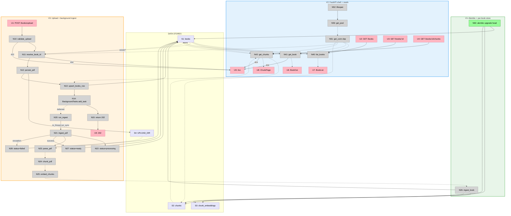

# Step 5 Slices — Vertical Implementation Increments

Slices the breadboard from [breadboard.md](./breadboard.md) into demo-able
vertical increments. Each slice cuts through all relevant layers (schema /
services / API) and ends in something an operator can observe — a printed eval
report, a `curl` response, or a status-column transition.

Order matters: V2 depends on V1's per-book store ops to have anything to read;
V3 depends on V2's pool + DI for the upload handler.

Affordance IDs reference [breadboard.md](./breadboard.md).

## Slice Summary

| #  | Slice                                  | Mechanism (Shape B parts) | Entry point                     | Observable output                                                                          |
| -- | -------------------------------------- | -------------------------- | ------------------------------- | ------------------------------------------------------------------------------------------ |
| V1 | Alembic + per-book store ops           | B3, B4                     | `make db-migrate` + Step 4 script | Eval report from `scripts/store_pdf_inspect.py` matches Step 3 baseline (Hit@5 8/8, MRR 0.729) after switching `load_book` → `ingest_book` |
| V2 | FastAPI shell + read endpoints         | B1, B2, B7, B8             | `uvicorn api.main:app`          | `GET /books`, `GET /books/:id`, `GET /books/:id/chunks?limit=…` return the V1-ingested book |
| V3 | Upload endpoint + background ingest    | B5, B6                     | `POST /books/upload`            | 202 + `book_id` returned immediately; `GET /books/:id` shows `pending → processing → ready`; re-upload with same `book_id` replaces only that book |

Three slices. Each delivers one B-block of mechanisms; together they cover all
of Shape B.

---

## V1 — Alembic + per-book store ops

**Mechanism:** B3 (Alembic adoption) + B4 (per-book store ops in `services/store.py`).

**Entry point:** `make db-migrate` (operator), then re-run the existing Step 4
debug script.

**Demo:** "Run `make db-migrate` against a fresh container. The schema now has
CASCADE FKs and `books.status` + `books.error_message`. Run
`python scripts/store_pdf_inspect.py` — it loads the AI Engineering PDF through
the new `ingest_book` (no `TRUNCATE`), prints the same Hit@5 8/8 / MRR 0.729
parity report Step 4 produced. Re-running does not duplicate."

### Affordances introduced in V1

| # | Place    | Component            | Affordance                                                              | Control | Wires Out          | Returns To |
| - | -------- | -------------------- | ----------------------------------------------------------------------- | ------- | ------------------ | ---------- |
| N60 | TRIGGER | `Makefile` + `alembic/` | `make db-migrate` → `alembic upgrade head` (revisions `_init`, `_chunks_cascade`, `_book_status`) | invoke  | → S1, → S2, → S3   | —          |
| N26 | P3       | `services/store.py`  | `ingest_book(conn, book_id, chunks, embeddings, title, file_path)` — replaces `load_book`. Single tx: `INSERT books … ON CONFLICT DO UPDATE`, `DELETE FROM chunks WHERE book_id=?` (CASCADE), `INSERT chunks` + `INSERT chunk_embeddings` | call    | → S1, → S2, → S3   | —          |
| S1 | —        | DB                   | `books` table **including** `status book_status NOT NULL DEFAULT 'pending'` + `error_message TEXT NULL` (added by `_book_status` revision) | store   | —                  | —          |
| S2 | —        | DB                   | `chunks` table with `book_id` FK **now CASCADE-deleting** (`_chunks_cascade`) | store   | —                  | —          |
| S3 | —        | DB                   | `chunk_embeddings` table with `chunk_id` FK **now CASCADE-deleting** | store   | —                  | —          |

### Files touched in V1

| File                                | Action                                                                                   |
| ----------------------------------- | ---------------------------------------------------------------------------------------- |
| `pyproject.toml`                    | Add `alembic` dependency                                                                 |
| `Makefile`                          | Create with `db-migrate: alembic upgrade head` target                                    |
| `alembic.ini`                       | Create; set `file_template` with timestamp (per spike) and `sqlalchemy.url` placeholder  |
| `alembic/env.py`                    | Create; read `DATABASE_URL` from env                                                     |
| `alembic/versions/*_init.py`        | Create; body = `db/schema.sql` verbatim                                                  |
| `alembic/versions/*_chunks_cascade.py` | Create; `ALTER TABLE chunks` + `ALTER TABLE chunk_embeddings` to add `ON DELETE CASCADE` |
| `alembic/versions/*_book_status.py` | Create; `CREATE TYPE book_status AS ENUM …`; `ALTER TABLE books ADD COLUMN status …`, `ADD COLUMN error_message TEXT` |
| `db/connection.py`                  | Modify — **remove** `init_db()`; keep `get_connection()` for scripts                     |
| `services/store.py`                 | Replace `load_book` with `ingest_book(conn, book_id, …)` — no `TRUNCATE`                 |
| `scripts/store_pdf_inspect.py`      | Update: call `ingest_book(conn, fixed_book_id, …)` instead of `load_book`               |
| `scripts/probe_pgvector.py`         | Update: drop `init_db()` call; Makefile target runs migrations instead                   |

### Done when

- `make db-migrate` against a fresh container leaves the DB at head with `status` enum, `error_message`, and CASCADE FKs in place
- `python scripts/store_pdf_inspect.py` loads the AI Engineering PDF via `ingest_book` and prints the Step 3 parity report (Hit@5 8/8, MRR 0.729) — modulo HNSW noise
- Re-running the script does not duplicate rows and does not `TRUNCATE` (verify a *second* book inserted manually before re-run survives the re-run)
- No FastAPI work yet

### Not yet in V1

- No FastAPI app, no pool (`get_connection()` from Step 4 still in use for scripts)
- No status writes — the script ingests synchronously, sets `status='ready'` directly at the end (or leaves it `pending` since Step 4 didn't care; revisit in V3 when background lifecycle kicks in)

---

## V2 — FastAPI shell + read endpoints

**Mechanism:** B1 (FastAPI app package) + B2 (pool in `db/connection.py`) +
B7 (read handlers) + B8 (config / boundaries).

**Entry point:** `uvicorn api.main:app --reload`, then `curl` against
`localhost:8000`.

**Demo:** "Boot the app. `curl :8000/books` returns a single-element JSON list
containing the V1-ingested book. `curl :8000/books/{id}` returns its metadata.
`curl :8000/books/{id}/chunks?limit=3&offset=0` returns three chunk rows with
their page ranges + total. `curl :8000/books/{nonexistent-uuid}` returns 404.
`uvicorn` boot does not apply migrations."

### Affordances introduced in V2

| #  | Place | Component             | Affordance                                                                                              | Control | Wires Out                | Returns To           |
| -- | ----- | --------------------- | ------------------------------------------------------------------------------------------------------- | ------- | ------------------------ | -------------------- |
| N50 | P2    | `db/connection.py`    | `get_pool() -> ConnectionPool` — lazy module-level `psycopg_pool.ConnectionPool` with `configure=register_vector` | call    | —                        | → N51                |
| N51 | P2    | `api/deps.py`         | `get_conn()` FastAPI dependency yielding a pooled connection                                            | call    | —                        | → N40, → N41, → N42  |
| N52 | P2    | `api/main.py`         | `lifespan(app)` — opens pool on startup, closes on shutdown; does **not** apply migrations              | observe | → N50                    | —                    |
| N40 | P2    | `api/routers/books.py` | `list_books()` — `SELECT … FROM books ORDER BY created_at DESC`                                         | call    | —                        | → U7                 |
| N41 | P2    | `api/routers/books.py` | `get_book(book_id)` — `SELECT … WHERE id=?`; 404 if missing                                             | call    | → U9 (404)               | → U6                 |
| N42 | P2    | `api/routers/books.py` | `get_chunks(book_id, limit, offset)` — existence check + paginated `SELECT` + `count(*)` for `total`     | call    | → U9 (404)               | → U8                 |
| U2 | P1    | curl/client           | `GET /books`                                                                                            | call    | → N40                    | —                    |
| U3 | P1    | curl/client           | `GET /books/:id`                                                                                        | call    | → N41                    | —                    |
| U4 | P1    | curl/client           | `GET /books/:id/chunks?limit=&offset=`                                                                  | call    | → N42                    | —                    |
| U6 | P1    | curl/client           | `200 BookOut` JSON (id, title, file_path, created_at, status, error_message?)                           | render  | —                        | —                    |
| U7 | P1    | curl/client           | `200 BookList` JSON                                                                                     | render  | —                        | —                    |
| U8 | P1    | curl/client           | `200 ChunkPage` JSON (`items`, `total`, `limit`, `offset`)                                              | render  | —                        | —                    |
| U9 | P1    | curl/client           | `4xx` error (`404`, `422`)                                                                              | render  | —                        | —                    |

### Files touched in V2

| File                       | Action                                                                                |
| -------------------------- | ------------------------------------------------------------------------------------- |
| `pyproject.toml`           | Add `fastapi`, `uvicorn[standard]`, `psycopg_pool`; add `api` to wheel packages       |
| `db/connection.py`         | Add `get_pool()` (lazy module-level `ConnectionPool` with `configure=register_vector`); keep `get_connection()` |
| `api/__init__.py`          | Create (empty)                                                                        |
| `api/main.py`              | Create — `FastAPI()`, lifespan opens/closes pool, mount `books_router`                |
| `api/deps.py`              | Create — `get_conn` dependency yielding from pool                                     |
| `api/schemas.py`           | Create — `BookOut`, `BookList`, `ChunkOut`, `ChunkPage`, `ErrorOut`                   |
| `api/routers/__init__.py`  | Create (empty)                                                                        |
| `api/routers/books.py`     | Create — `list_books`, `get_book`, `get_chunks` handlers (no upload yet)              |
| `.env.example` / `.env`    | Note: no new vars in V2 (still `DATABASE_URL`, `GEMINI_API_KEY` from earlier steps)   |

### Done when

- `uvicorn api.main:app` boots without running migrations (R4.2) — verified by `alembic stamp base` then booting and confirming no DDL ran
- Pool open/close visible in logs across startup/shutdown
- `GET /books` returns the V1-ingested book
- `GET /books/:id` returns `BookOut` or `404` for unknown id
- `GET /books/:id/chunks?limit=3&offset=0` returns 3 chunks + `total=1286`; `limit=300` is rejected with 422 (cap is 200); `limit=0` is rejected with 422
- `services/` and `db/` import no FastAPI symbols (R3.2 — verified by grep)
- Step 4 scripts still run unchanged (`scripts/store_pdf_inspect.py`, `scripts/embed_pdf_inspect.py`, `scripts/probe_pgvector.py`) — they use `get_connection`, not the pool

### Not yet in V2

- No upload (no `POST /books/upload`)
- No background processing — V1 set `status='ready'` directly; no transition logic exists yet
- No file persistence

---

## V3 — Upload endpoint + background ingest

**Mechanism:** B5 (background orchestrator in `services/ingest.py`) + B6
(upload handler).

**Entry point:** `POST /books/upload` with multipart PDF.

**Demo:** "`curl -F file=@book.pdf -F title='AI Engineering' :8000/books/upload`
returns `202 {book_id, status:'pending'}` within ~1 second. The file lands at
`uploads/{book_id}.pdf`. Polling `GET /books/:id` shows the row transition
`pending → processing → ready` over the next few minutes. Chunks become readable
via `GET /books/:id/chunks` (the V2 handler from V2 just works on the new
book). Force a failure (corrupt PDF) and the row lands at `status='failed'`
with a non-empty `error_message`. Re-upload with `book_id` set to an existing
id replaces only that book's chunks + embeddings; a sibling book is
untouched. `book_id` set to an unknown id returns 404."

### Affordances introduced in V3

| #   | Place | Component                | Affordance                                                                                          | Control | Wires Out                                              | Returns To       |
| --- | ----- | ------------------------ | --------------------------------------------------------------------------------------------------- | ------- | ------------------------------------------------------ | ---------------- |
| N10 | P2    | `api/routers/books.py`   | `validate_upload(file, title, book_id?)` — content-type, size cap, title non-empty                  | call    | → N11, → U9 (422)                                      | —                |
| N11 | P2    | `api/routers/books.py`   | `resolve_book_id(book_id?)` — id given + exists → re-ingest; given + missing → 404; absent → uuid4  | call    | → N12, → U9 (404)                                      | —                |
| N12 | P2    | `api/routers/books.py`   | `persist_pdf(book_id, file)` → `{UPLOAD_DIR}/{book_id}.pdf`                                         | call    | → S4, → N13                                             | —                |
| N13 | P2    | `api/routers/books.py`   | `upsert_books_row(book_id, title, file_path)` — `INSERT … ON CONFLICT (id) DO UPDATE SET title=…, file_path=…, status='pending', error_message=NULL` | call    | → S1, → N14                                             | —                |
| N14 | P2    | `api/routers/books.py`   | `BackgroundTasks.add_task(run_ingest, book_id, pdf_path, title)`                                    | call    | → N15, → N20 *(deferred)*                              | —                |
| N15 | P2    | `api/routers/books.py`   | `return UploadResponse(book_id, status='pending')` (HTTP 202)                                       | call    | → U5                                                    | —                |
| N20 | P2    | `services/ingest.py`     | `async run_ingest(book_id, pdf_path, title)` — `await anyio.to_thread.run_sync(ingest_pdf, …)`     | call    | → N21                                                  | —                |
| N21 | P3    | `services/ingest.py`     | `ingest_pdf(book_id, pdf_path, title)` — opens pooled conn; orchestrates N22 → N23 → … → N27; `except:` → N28 | call    | → N22, → N23, → N24, → N25, → N26, → N27, → N28        | —                |
| N22 | P3    | `services/ingest.py`     | `set_status('processing')` — `UPDATE books SET status='processing' WHERE id=?`                      | call    | → S1                                                   | —                |
| N23 | P3    | `services/pdf_parser.py` | `parse_pdf(pdf_path)` (reuses Step 1)                                                              | call    | —                                                      | → N21 (`doc`)    |
| N24 | P3    | `services/chunker.py`    | `chunk_pdf(doc)` (reuses Step 2)                                                                   | call    | —                                                      | → N21 (`chunks`) |
| N25 | P3    | `services/embeddings.py` | `embed_chunks(chunks)` (reuses Step 3)                                                             | call    | —                                                      | → N21 (`embeddings`) |
| N27 | P3    | `services/ingest.py`     | `set_status('ready')` (success)                                                                    | call    | → S1                                                   | —                |
| N28 | P3    | `services/ingest.py`     | `set_status('failed', error_message)` — fresh tx, **any** exception                                | call    | → S1                                                   | —                |
| U1  | P1    | curl/client              | `POST /books/upload` (multipart PDF + `title` [+ optional `book_id`])                              | call    | → N10                                                  | —                |
| U5  | P1    | curl/client              | `202 Accepted` `{book_id, status:'pending'}`                                                       | render  | —                                                      | —                |
| S4  | —     | local FS                 | `{UPLOAD_DIR}/{book_id}.pdf` — one file per book                                                   | store   | —                                                      | —                |

N26 (`ingest_book`) is reused from V1 — wired here from N21 instead of from the
inspect script.

### Files touched in V3

| File                       | Action                                                                                                |
| -------------------------- | ----------------------------------------------------------------------------------------------------- |
| `pyproject.toml`           | Add `python-multipart` (FastAPI form parsing), `anyio` is already a FastAPI transitive dep            |
| `.env.example` / `.env`    | Add `UPLOAD_DIR=uploads`, `MAX_UPLOAD_MB=100`                                                         |
| `.gitignore`               | Add `uploads/`                                                                                        |
| `api/main.py`              | Modify — create `UPLOAD_DIR` on startup if missing                                                    |
| `api/schemas.py`           | Add `UploadRequest` (form fields) and `UploadResponse`                                                |
| `api/routers/books.py`     | Add `POST /books/upload` handler chaining N10 → N15                                                   |
| `services/ingest.py`       | Create — `ingest_pdf` (sync orchestrator) + `run_ingest` (async wrapper)                              |

### Done when

- `POST /books/upload` of a fresh PDF (no `book_id`) returns `202` + `book_id` within ~1s; file at `uploads/{book_id}.pdf`; row in `books` with `status='pending'`
- Background task transitions `status` `pending → processing → ready` (visible via repeated `GET /books/:id`); `chunks` + `chunk_embeddings` populated for that `book_id`
- A second `POST /books/upload` for an unrelated book runs concurrently without blocking the first; the first book's rows are unchanged
- `POST /books/upload` with `book_id` set to an existing id: file overwrites at `uploads/{book_id}.pdf`; prior `chunks` + `chunk_embeddings` for that book are deleted (CASCADE) and re-inserted; sibling book untouched
- `POST /books/upload` with `book_id` set to an unknown id returns `404 unknown book_id; omit to create new`
- Forcing an exception in `parse_pdf` (e.g. zero-byte file) lands the row in `status='failed'` with `error_message` populated; the row never stays at `processing`
- Server crash mid-ingest still leaves the row at `processing` — documented known gap (R7.3), not fixed
- Concurrent `GET /books/:id/chunks` against a book at `status='processing'` returns whatever chunks have already been inserted (partial — Step 6 will gate retrieval on `status='ready'`; out of scope here)

### Not yet in V3 (Step 6+)

- No retrieval endpoint (`POST /books/:id/ask`)
- No status-based read gating
- No startup sweep for rows stuck in `processing` (R7.3 documented gap)
- No `GET /books` filter by status (frontend convenience, not MVP)

---

## Slice Diagram

## Coverage Check

Every affordance from the breadboard is assigned to exactly one slice:

| Affordance group | V1 | V2 | V3 |
| ---------------- | -- | -- | -- |
| Triggers (N60)               | ✅ |    |    |
| Stores (S1–S3)               | ✅ |    |    |
| Store (S4)                   |    |    | ✅ |
| Per-book store ops (N26)     | ✅ |    |    |
| Pool + DI + lifespan (N50–N52) |    | ✅ |    |
| Read handlers (N40–N42)      |    | ✅ |    |
| Read UI (U2–U4, U6–U9)       |    | ✅ |    |
| Upload chain (N10–N15)       |    |    | ✅ |
| Upload UI (U1, U5)           |    |    | ✅ |
| Background (N20–N28)         |    |    | ✅ |

Every Shape B part from `shaping.md` is delivered by some slice:

| B part | Slice |
| ------ | ----- |
| B1.1 (FastAPI app + lifespan) | V2 |
| B1.2 (routers/books.py routes) | V2 (reads) + V3 (upload) |
| B1.3 (deps.py) | V2 |
| B1.4 (schemas.py) | V2 (response shapes) + V3 (request shape) |
| B2.1 (pool with register_vector) | V2 |
| B2.2 (script-side get_connection unchanged) | V1 (verified) |
| B3.1–B3.5 (Alembic adoption, three revisions, init_db removed) | V1 |
| B4.1–B4.3 (ingest_book + script update) | V1 |
| B5.1–B5.3 (ingest orchestrator) | V3 |
| B6.1–B6.6 (upload handler chain) | V3 |
| B7.1–B7.3 (read handlers) | V2 |
| B8 (env / boundaries) | V2 (FastAPI boundaries) + V3 (UPLOAD_DIR vars) |

## Next Step

Write `V1-plan.md` with concrete file diffs for the V1 slice. V2-plan.md and
V3-plan.md follow after V1 lands.
