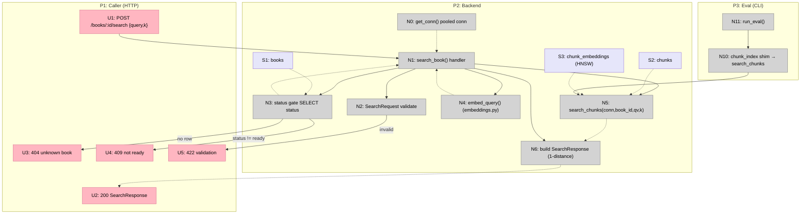

# Step 6: Retrieval API — Breadboard (Detail A)

Detailing **Shape A** (see [shaping.md](./shaping.md)) into concrete affordances.

Two workflows:

1. **Search request** (the operator is an HTTP caller): `POST /books/{book_id}/search`
   with `{query, k}` → top-k chunks, or `404` / `409` / `422`.
2. **Eval parity** (the operator is a developer running the script): A6's
   `store_pdf_inspect.py` drives `run_eval` through a `chunk_index` shim over the
   same `search_chunks` the API ships.

## Places

| #   | Place          | Description                                                                 |
| --- | -------------- | --------------------------------------------------------------------------- |
| P1  | Caller (HTTP)  | The client issuing the request and reading the response (no app frontend)   |
| P2  | Backend        | FastAPI handler + `services/` + pooled psycopg connection + Postgres        |
| P3  | Eval (CLI)     | `scripts/store_pdf_inspect.py` developer trigger — A6 parity path           |

## UI Affordances

| #   | Place | Component         | Affordance                                                | Control | Wires Out | Returns To |
| --- | ----- | ----------------- | --------------------------------------------------------- | ------- | --------- | ---------- |
| U1  | P1    | HTTP client       | `POST /books/{book_id}/search` body `{query, k?}`         | call    | → N1      | —          |
| U2  | P1    | HTTP client       | `200` `SearchResponse {book_id, query, k, hits[]}`        | render  | —         | —          |
| U3  | P1    | HTTP client       | `404` unknown `book_id`                                   | render  | —         | —          |
| U4  | P1    | HTTP client       | `409` book not `ready` (status echoed in detail)          | render  | —         | —          |
| U5  | P1    | HTTP client       | `422` validation error (empty query / `k` out of range)   | render  | —         | —          |

## Code Affordances

| #   | Place | Component                  | Affordance                                                                                 | Control     | Wires Out                | Returns To       |
| --- | ----- | -------------------------- | ------------------------------------------------------------------------------------------ | ----------- | ------------------------ | ---------------- |
| N0  | P2    | `api/deps.py`              | `get_conn()` — yields pooled `Connection[DictRow]`                                          | call        | —                        | → N1             |
| N1  | P2    | `api/routers/books.py`     | `search_book(book_id, body, conn=Depends(get_conn))` handler                               | call        | → N2, → N3, → N4, → N5, → N6 | —             |
| N2  | P2    | `api/schemas.py`           | `SearchRequest{query: str, k: int = Field(5, ge=1, le=20)}` validation (non-empty `query`) | validate    | → U5 (on fail)           | → N1             |
| N3  | P2    | `api/routers/books.py`     | status gate: `SELECT status FROM books WHERE id=%s`                                         | call (read) | → U3 (none), → U4 (≠ready) | → N1           |
| N4  | P2    | `services/embeddings.py`   | 🟡 `embed_query(query) -> list[float]` (RETRIEVAL_QUERY, L2-norm) — **relocated here (A3)** | call        | —                        | → N1             |
| N5  | P2    | `services/retrieval.py`    | 🟡 `search_chunks(conn, book_id, query_vec, k) -> list[ChunkHit]` — `<=>` + HNSW, `WHERE book_id` (A1) | call (read) | —              | → N1, → N6       |
| N6  | P2    | `api/routers/books.py`     | build `SearchResponse`: map `ChunkHit → SearchHit`, `score = 1 - distance`                 | call        | —                        | → U2             |
| N10 | P3    | `scripts/store_pdf_inspect`| 🟡 `Retriever` shim `lambda qv, k: [h.chunk_index for h in search_chunks(conn, BOOK_ID, qv, k)]` (A6) | call | → N5            | → N11            |
| N11 | P3    | `services/eval.py`         | `run_eval(cases, chunks, retriever, k)` — unchanged                                        | call        | → N10                    | —                |

## Data Stores

| #   | Place | Store                      | Description                                                                          |
| --- | ----- | -------------------------- | ------------------------------------------------------------------------------------ |
| S1  | P2    | `books`                    | Read for the status gate (N3); `status` ∈ pending/processing/ready/failed            |
| S2  | P2    | `chunks`                   | `book_id`-scoped; joined for citation metadata (chunk_index, text, page, section)    |
| S3  | P2    | `chunk_embeddings`         | `vector(1536)`; ordered by `<=>` over the HNSW index (N5)                             |

## Notes on new vs existing

- **NEW:** N1 (handler) + the `/books/{book_id}/search` route, N5 `search_chunks`,
  N6 response mapping, `SearchRequest` / `SearchHit` / `SearchResponse` schemas (A5).
- **MOVED:** N4 `embed_query` `services/eval.py` → `services/embeddings.py` (A3);
  `eval.py` re-imports it.
- **CHANGED:** N10 — the eval `Retriever` is rewired from the (deleted) `retrieve_pg`
  onto `search_chunks` via a `chunk_index` shim (A6).
- **UNCHANGED:** N0 `get_conn`, N11 `run_eval`, S1–S3 schema (no migration this step).
- **DELETED:** `retrieve_pg` (no remaining callers after N10).

## Mermaid

## Orthogonal concerns surfaced

- **Validation (N2)** is pure Pydantic/FastAPI — independent of retrieval.
- **Status gate (N3)** is independent of embedding/retrieval — a book existence +
  readiness check reusable by any future per-book endpoint.
- **`embed_query` relocation (N4/A3)** and **`search_chunks` (N5/A1)** are
  independent units; A6's eval rewire depends only on N5.
