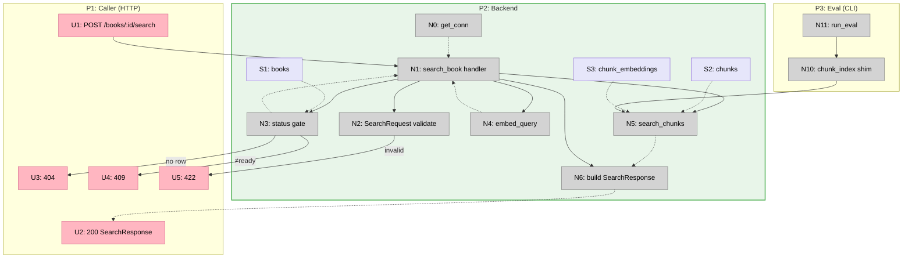

# Step 6 Slices — Vertical Implementation Increments

Slices the breadboard from [breadboard.md](./breadboard.md) into demo-able
vertical increments. Affordance IDs reference [breadboard.md](./breadboard.md);
mechanism IDs reference Shape A in [shaping.md](./shaping.md).

Step 6 is one endpoint over an already-working pipeline, so it collapses to a
**single slice**. The eval-parity rewire (A6) ships in the same slice because it
shares the very function the endpoint calls (`search_chunks`, A1) — splitting it
out would be a horizontal layer, not a vertical demo.

## Slice Summary

| #  | Slice              | Mechanism (Shape A) | Entry point                       | Observable output                                                                                                  |
| -- | ------------------ | ------------------- | --------------------------------- | ------------------------------------------------------------------------------------------------------------------ |
| V1 | Book-scoped search | A1, A3, A4, A5, A6  | `POST /books/{id}/search` + script | `curl` a `ready` book's `/search` → ranked chunks w/ scores + citations; `404`/`409`/`422` on the edge cases; eval parity report still matches the Step 3 baseline through the new `search_chunks` |

One slice. Delivers all of Shape A.

---

## V1 — Book-scoped search

**Mechanism:** A1 (`search_chunks`) + A3 (`embed_query` → `services/embeddings.py`)
+ A4 (search handler) + A5 (schemas) + A6 (eval rewired onto `search_chunks`,
`retrieve_pg` deleted per A2).

**Entry point:** `POST /books/{book_id}/search` with `{query, k}`; and
`python scripts/store_pdf_inspect.py` for the parity path.

**Demo:**

> Boot `uvicorn api.main:app`. Upload + let a book reach `ready` (Step 5 flow).
> `curl -X POST :8000/books/{id}/search -H 'content-type: application/json'
> -d '{"query":"what is RAG?","k":5}'` returns `200` with up to 5 chunks ordered
> by similarity — each carrying `chunk_index`, `text`, `page_start/end`,
> `section_title/path`, and a `score`. Searching an unknown id → `404`; a book
> still `processing`/`failed` → `409`; an empty `query` or `k=0`/`k=21` → `422`.
> Then `python scripts/store_pdf_inspect.py` prints the same Hit@5 8/8 / MRR
> 0.729 parity report — now driven through `search_chunks`, not the deleted
> `retrieve_pg`.

### Affordances introduced in V1

| #   | Place | Component                  | Affordance                                                                                          | Control     | Wires Out                    | Returns To   |
| --- | ----- | -------------------------- | --------------------------------------------------------------------------------------------------- | ----------- | ---------------------------- | ------------ |
| U1  | P1    | curl/client                | `POST /books/{book_id}/search` body `{query, k?}`                                                   | call        | → N1                         | —            |
| U2  | P1    | curl/client                | `200 SearchResponse {book_id, query, k, hits[]}`                                                    | render      | —                            | —            |
| U3  | P1    | curl/client                | `404` unknown `book_id`                                                                              | render      | —                            | —            |
| U4  | P1    | curl/client                | `409` book not `ready`                                                                               | render      | —                            | —            |
| U5  | P1    | curl/client                | `422` validation (empty query / `k` ∉ [1,20])                                                        | render      | —                            | —            |
| N1  | P2    | `api/routers/books.py`     | `search_book(book_id, body, conn=Depends(get_conn))`                                                 | call        | → N2, → N3, → N4, → N5, → N6 | —            |
| N2  | P2    | `api/schemas.py`           | `SearchRequest` validation (`query` non-blank, `k` ∈ [1,20])                                         | validate    | → U5 (fail)                  | → N1         |
| N3  | P2    | `api/routers/books.py`     | status gate `SELECT status FROM books WHERE id=%s`                                                   | call (read) | → U3 (none), → U4 (≠ready)   | → N1         |
| N4  | P2    | `services/embeddings.py`   | `embed_query(query)` — relocated from `services/eval.py` (A3)                                         | call        | —                            | → N1         |
| N5  | P2    | `services/retrieval.py`    | `search_chunks(conn, book_id, query_vec, k) -> list[ChunkHit]` (A1)                                  | call (read) | —                            | → N1, → N6   |
| N6  | P2    | `api/routers/books.py`     | build `SearchResponse`, `score = 1 - distance`                                                       | call        | —                            | → U2         |
| N10 | P3    | `scripts/store_pdf_inspect`| `chunk_index` shim over `search_chunks` (A6) replacing the deleted `retrieve_pg`                     | call        | → N5                         | → N11        |

Reused unchanged: N0 `get_conn`, N11 `run_eval`, S1 `books`, S2 `chunks`,
S3 `chunk_embeddings`.

### Files touched in V1

| File                            | Action                                                                                          |
| ------------------------------- | ----------------------------------------------------------------------------------------------- |
| `services/embeddings.py`        | Add `embed_query` (moved from `eval.py`)                                                         |
| `services/eval.py`              | Remove `embed_query` def; `from services.embeddings import embed_query` (re-export); prune now-unused imports |
| `services/retrieval.py`         | Replace `retrieve_pg` with `search_chunks` + `ChunkHit` TypedDict                               |
| `api/schemas.py`                | Add `SearchRequest`, `SearchHit`, `SearchResponse`                                              |
| `api/routers/books.py`          | Add `POST /{book_id}/search` handler + imports                                                  |
| `scripts/store_pdf_inspect.py`  | Rewire eval `Retriever` onto `search_chunks`; drop `retrieve_pg` import                         |
| `tests/conftest.py`             | Stub `api.routers.books.embed_query` (no Gemini in tests)                                        |
| `tests/test_search.py`          | Create — 404 / 409 / 422 / happy / scoping                                                       |

### Done when

- `POST /books/{id}/search` on a `ready` book returns `200` with ≤ `k` hits
  ordered by descending `score`, each with chunk text + page/section citation
- Unknown `book_id` → `404`; book `pending`/`processing`/`failed` → `409`;
  empty/blank `query` or `k ∉ [1,20]` → `422`
- A search on book A never returns book B's chunks (scoping test:
  `k=200` returns exactly book A's chunk count)
- `grep` confirms no FastAPI import in `services/` or `db/` (R4.2); the handler
  acquires its connection only via `Depends(get_conn)` (R4.3)
- `retrieve_pg` is gone; `python scripts/store_pdf_inspect.py` runs through
  `search_chunks` and prints Hit@5 8/8 / MRR 0.729 (modulo HNSW noise) — R5.1
- `pytest` green

### Not yet in V1 (Step 7+)

- No LLM answer / prompt assembly (`POST /books/{id}/ask`) — R6.1
- No cross-book / multi-book search — R3.2
- No reranking, no hybrid/BM25 — R6.2
- No startup sweep for rows stuck in `processing` (R7.3 known gap carried from Step 5)

## Slice Diagram

## Coverage Check

Every Shape A part is delivered by V1:

| A part | Slice | Affordance |
| ------ | ----- | ---------- |
| A1 (`search_chunks`)                  | V1 | N5 |
| A2 (retire `retrieve_pg`)             | V1 | (deletion; N10 rewires off it) |
| A3 (`embed_query` → `embeddings.py`)  | V1 | N4 |
| A4 (search handler + gating)          | V1 | N1, N3, N6 |
| A5 (schemas)                          | V1 | N2 (+ U2 shape) |
| A6 (eval rewired onto `search_chunks`)| V1 | N10 |

## Next Step

Write [V1-plan.md](./V1-plan.md) with concrete file diffs.
