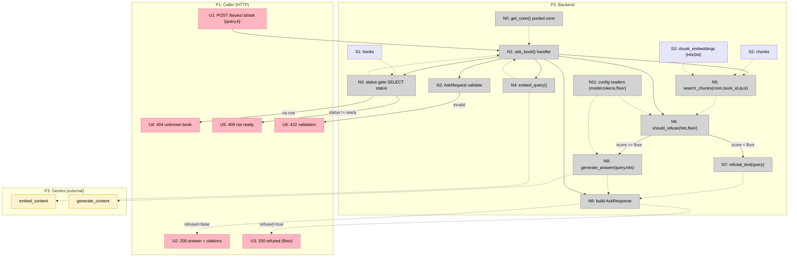

# Step 7: Grounded Answer API — Breadboard (Shape A)

Detailing **Shape A** (see [shaping.md](./shaping.md)) into concrete affordances.
Affordance tables are the source of truth; the Mermaid is rendered from them.

Two workflows over one endpoint:

1. **Ask → grounded answer** (operator is an HTTP caller): `POST /books/{book_id}/ask`
   with `{query, k}` → `200` answer + inline `[n]` citations.
2. **Ask → refusal** (same call, weak retrieval): best hit `score < ASK_SCORE_FLOOR`
   → `200` with `refused=true`, a language-matched refusal string, empty citations,
   **no Gemini generation call**.

Edge cases: `404` / `409` / `422`, gated before any embed/LLM work.

## Places

| #  | Place         | Description                                                                   |
|----|---------------|-------------------------------------------------------------------------------|
| P1 | Caller (HTTP) | The client issuing the request and reading the response (no app frontend)     |
| P2 | Backend       | FastAPI handler + `services/` + pooled psycopg connection + Postgres          |
| P3 | Gemini (ext)  | Google Gemini API — embedding (existing) + generation (new this step)         |

## UI Affordances

| #  | Place | Component   | Affordance                                                                                      | Control | Wires Out | Returns To |
|----|-------|-------------|------------------------------------------------------------------------------------------------|---------|-----------|------------|
| U1 | P1    | HTTP client | `POST /books/{book_id}/ask` body `{query, k?}`                                                  | call    | → N1      | —          |
| U2 | P1    | HTTP client | `200` `AskResponse {book_id, query, k, answer, refused:false, citations[]}` (grounded)          | render  | —         | —          |
| U3 | P1    | HTTP client | `200` `AskResponse {…, answer:<refusal>, refused:true, citations:[]}` (floor short-circuit)     | render  | —         | —          |
| U4 | P1    | HTTP client | `404` unknown `book_id`                                                                         | render  | —         | —          |
| U5 | P1    | HTTP client | `409` book not `ready` (status echoed in detail)                                                | render  | —         | —          |
| U6 | P1    | HTTP client | `422` validation error (blank `query` / `k ∉ [1,20]`)                                           | render  | —         | —          |

## Code Affordances

| #   | Place | Component                | Affordance                                                                                                         | Control     | Wires Out                         | Returns To   |
|-----|-------|--------------------------|-------------------------------------------------------------------------------------------------------------------|-------------|-----------------------------------|--------------|
| N0  | P2    | `api/deps.py`            | `get_conn()` — yields pooled `Connection[DictRow]` (reused)                                                        | call        | —                                 | → N1         |
| N1  | P2    | `api/routers/books.py`   | 🟡 `ask_book(book_id, body, conn=Depends(get_conn))` handler (A3) — orchestrates only                              | call        | → N2,→N3,→N4,→N5,→N6,→N9          | —            |
| N2  | P2    | `api/schemas.py`         | 🟡 `AskRequest` validation — `{query:str non-blank, k:int∈[1,20]=5}` (subclass/share of `SearchRequest`) (A4/F2)   | validate    | → U6 (on fail)                    | → N1         |
| N3  | P2    | `api/routers/books.py`   | status gate `SELECT status FROM books WHERE id=%s` (reused from `search_book`)                                     | call (read) | → U4 (none), → U5 (≠ready)        | → N1         |
| N4  | P2    | `services/embeddings.py` | `embed_query(query) -> list[float]` (reused, no change)                                                            | call        | → P3 (embed)                      | → N1         |
| N5  | P2    | `services/retrieval.py`  | `search_chunks(conn, book_id, qv, k) -> list[ChunkHit]` (reused, no change)                                        | call (read) | —                                 | → N1, → N6   |
| N6  | P2    | `services/generate.py`   | 🟡 `should_refuse(hits, floor) -> bool` (A2) — `not hits or (1 - hits[0].distance) < floor`                        | call        | → N7 (true), → N8 (false)         | → N1         |
| N7  | P2    | `services/generate.py`   | 🟡 `refusal_text(query) -> str` (A2/F1) — language-matched via `_is_cjk` (ZH if CJK, else EN); no model call       | call        | —                                 | → N9         |
| N8  | P2    | `services/generate.py`   | 🟡 `generate_answer(query, hits) -> str` (A1) — build grounded `[n]` prompt + `generate_content` (temp=0, bounded) | call        | → N11, → P3 (generate)            | → N9         |
| N9  | P2    | `api/routers/books.py`   | 🟡 build `AskResponse` (A3) — number hits `1..k` → `citations` (drop `distance`, add `marker` + `score`); set `answer`,`refused` | call | —                          | → U2, → U3   |
| N11 | P2    | `services/generate.py`   | 🟡 config readers (A5): `_gen_model()`, `_max_output_tokens()` (env, defaults); `_score_floor()` read in handler   | call        | —                                 | → N6, → N8   |

## Data Stores

| #  | Place | Store              | Description                                                                       |
|----|-------|--------------------|----------------------------------------------------------------------------------|
| S1 | P2    | `books`            | Read for the status gate (N3); `status` ∈ pending/processing/ready/failed         |
| S2 | P2    | `chunks`           | `book_id`-scoped; joined for citation metadata (chunk_index, text, page, section)  |
| S3 | P2    | `chunk_embeddings` | `vector(1536)`; ordered by `<=>` over HNSW (N5)                                    |

## Notes on new vs existing

- **NEW:** N1 (`ask_book` handler) + the `/books/{book_id}/ask` route; the
  `services/generate.py` module — N6 `should_refuse`, N7 `refusal_text`,
  N8 `generate_answer`, N11 config readers; N9 response mapping;
  `AskRequest` / `Citation` / `AskResponse` schemas (A4); generation leg of P3.
- **REUSED unchanged:** N0 `get_conn`, N3 status-gate pattern (copied from
  `search_book`), N4 `embed_query`, N5 `search_chunks`, S1–S3, the embedding
  leg of P3, `services/types.py:ChunkBase`, `services/embeddings.py:make_client`
  + retry conventions (N8 reuses them).
- **CHANGED:** none of Step 6's shipped code paths change — Step 7 is additive.

## Mermaid

## Orthogonal concerns surfaced

- **Validation (N2)** and **status gate (N3)** are pure carries from `search_book`
  — independent of generation; the gate is the same existence+readiness check.
- **Refusal floor (N6/N7)** is independent of generation — a pure function over
  `hits` + a float threshold; testable with hand-built `ChunkHit`s, no Gemini.
- **`generate_answer` (N8)** is the only new external-call unit; it composes
  prompt-assembly (pure, testable on its own) + a single `generate_content` call.
  Stub the call (N8) → the whole handler is deterministic (R5.1).
- **Config readers (N11)** are independent env lookups (mirror `_upload_dir`);
  `_score_floor` feeds N6 in the handler, `_gen_model`/`_max_output_tokens` feed N8.

## Open Questions by Part

- **N7 (F1):** language pick — `_is_cjk` heuristic on the query (lean) vs a fixed
  single-language refusal. Heuristic chosen; revisit if non-CJK non-EN books land.
- **N2 (F2):** `AskRequest` subclass of `SearchRequest` vs shared base. Lean:
  subclass (identical fields) to avoid validator drift.
- **N8 (F3):** prompt template home — module-level constant in `generate.py`
  (lean, V1) vs a separate `prompts/` file. No blocker.
- **N9:** `citations` = all `k` numbered sources (Shape A). Faithful marker-only
  filtering is Shape B, deferred.

## Next Step

Slice the breadboard ([slices.md](./slices.md)) — a single vertical slice is
expected (one endpoint, one new service module, three schemas, one prompt
template), then write [V1-plan.md](./V1-plan.md) with concrete file diffs.
