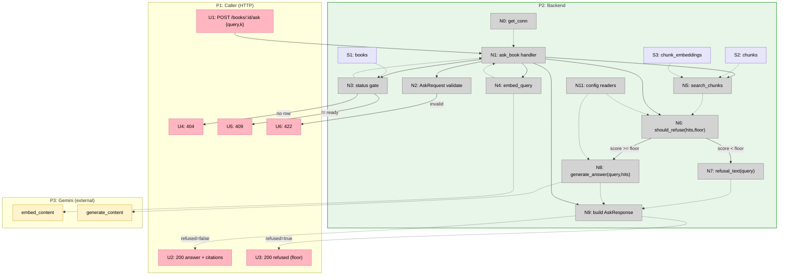

# Step 7 Slices — Vertical Implementation Increments

Slices the breadboard from [breadboard.md](./breadboard.md) into demo-able
vertical increments. Affordance IDs (N1, U2, …) reference
[breadboard.md](./breadboard.md); mechanism IDs (A1–A6) reference Shape A in
[shaping.md](./shaping.md).

Step 7 is one endpoint over the already-working Step 6 retrieval path, so it
collapses to a **single vertical slice**. The refusal-floor branch ships in the
same slice because it shares the very handler + service module the grounded path
uses (`ask_book` + `services/generate.py`) — splitting "refusal" out would be a
horizontal layer, not a vertical demo.

## Slice Summary

| #  | Slice            | Mechanism (Shape A) | Entry point              | Observable output                                                                                                                              |
|----|------------------|---------------------|--------------------------|----------------------------------------------------------------------------------------------------------------------------------------------|
| V1 | Grounded `/ask`  | A1–A6               | `POST /books/{id}/ask`   | `curl` a `ready` book's `/ask` → grounded answer with inline `[n]` citations + numbered sources; an out-of-scope query → `refused=true` answer, no Gemini call; `404`/`409`/`422` on the edges |

One slice. Delivers all of Shape A.

---

## V1 — Grounded `/ask`

**Mechanism:** A1 (`generate_answer`) + A2 (`should_refuse` / `refusal_text`
floor branch) + A3 (`ask_book` handler) + A4 (schemas) + A5 (env config readers)
+ A6 (tests).

**Entry point:** `POST /books/{book_id}/ask` with `{query, k}`.

**Demo:**

> Boot `uvicorn api.main:app`. Upload + let a book reach `ready` (Step 5 flow).
>
> `curl -X POST :8000/books/{id}/ask -H 'content-type: application/json'
> -d '{"query":"What is RAG?","k":5}'` returns `200` with an `answer` that cites
> its sources inline as `[1]`,`[2]`, `refused=false`, and a `citations[]` array of
> the numbered source chunks (each with `marker`, `text`, `page_start/end`,
> `section_title/path`, `score`).
>
> A Traditional-Chinese question `{"query":"什麼是檢索增強生成？"}` returns a
> Chinese answer (mirrors query language).
>
> An out-of-scope question `{"query":"How do I bake sourdough?"}` returns `200`
> with `refused=true`, a language-matched refusal string, `citations:[]`, and
> **no Gemini generation call** (best hit below `ASK_SCORE_FLOOR`).
>
> Searching an unknown id → `404`; a book still `processing`/`failed` → `409`;
> an empty `query` or `k=0`/`k=21` → `422`.

### Affordances introduced in V1

| #   | Place | Component                | Affordance                                                                                          | Control     | Wires Out                  | Returns To |
|-----|-------|--------------------------|----------------------------------------------------------------------------------------------------|-------------|----------------------------|------------|
| U1  | P1    | curl/client              | `POST /books/{book_id}/ask` body `{query, k?}`                                                      | call        | → N1                       | —          |
| U2  | P1    | curl/client              | `200 AskResponse` grounded (`answer` + `citations[]`, `refused:false`)                              | render      | —                          | —          |
| U3  | P1    | curl/client              | `200 AskResponse` refused (`answer`=refusal, `citations:[]`, `refused:true`)                        | render      | —                          | —          |
| U4  | P1    | curl/client              | `404` unknown `book_id`                                                                             | render      | —                          | —          |
| U5  | P1    | curl/client              | `409` book not `ready`                                                                              | render      | —                          | —          |
| U6  | P1    | curl/client              | `422` validation (blank query / `k ∉ [1,20]`)                                                       | render      | —                          | —          |
| N1  | P2    | `api/routers/books.py`   | `ask_book(book_id, body, conn=Depends(get_conn))` handler (A3)                                      | call        | → N2,→N3,→N4,→N5,→N6,→N9   | —          |
| N2  | P2    | `api/schemas.py`         | `AskRequest` validation (`query` non-blank, `k ∈ [1,20]`) (A4)                                      | validate    | → U6 (fail)                | → N1       |
| N3  | P2    | `api/routers/books.py`   | status gate `SELECT status FROM books WHERE id=%s` (reused)                                         | call (read) | → U4 (none), → U5 (≠ready) | → N1       |
| N4  | P2    | `services/embeddings.py` | `embed_query(query)` (reused)                                                                       | call        | → P3 embed                 | → N1       |
| N5  | P2    | `services/retrieval.py`  | `search_chunks(conn, book_id, qv, k)` (reused)                                                      | call (read) | —                          | → N1, → N6 |
| N6  | P2    | `services/generate.py`   | `should_refuse(hits, floor)` (A2)                                                                   | call        | → N7 (true), → N8 (false)  | → N1       |
| N7  | P2    | `services/generate.py`   | `refusal_text(query)` — `_is_cjk` language pick (A2)                                                | call        | —                          | → N9       |
| N8  | P2    | `services/generate.py`   | `generate_answer(query, hits)` — grounded prompt + `generate_content` (A1)                          | call        | → N11, → P3 generate       | → N9       |
| N9  | P2    | `api/routers/books.py`   | build `AskResponse` — number hits `1..k` → `citations` (drop `distance`, add `marker` + `score`)    | call        | —                          | → U2, → U3 |
| N11 | P2    | `services/generate.py`   | env config readers (A5): `_gen_model`, `_max_output_tokens`; `_score_floor` (handler)               | call        | —                          | → N6, → N8 |

Reused unchanged: N0 `get_conn`, N4 `embed_query`, N5 `search_chunks`, S1 `books`,
S2 `chunks`, S3 `chunk_embeddings`, `services/types.py:ChunkBase`,
`services/embeddings.py:make_client` + retry conventions.

### Files touched in V1

| File                       | Action                                                                                       |
|----------------------------|----------------------------------------------------------------------------------------------|
| `services/generate.py`     | Create — `generate_answer` (A1), `should_refuse` + `refusal_text` (A2), prompt template, env readers (A5), `make_client`/retry reuse |
| `api/schemas.py`           | Add `AskRequest` (subclass `SearchRequest`), `Citation` (`ChunkBase` + `marker` + `score`), `AskResponse` (A4) |
| `api/routers/books.py`     | Add `POST /{book_id}/ask` handler + imports (A3); `_score_floor` env reader                   |
| `.env.example`             | Add `GEMINI_GEN_MODEL`, `ASK_SCORE_FLOOR`, `ASK_MAX_OUTPUT_TOKENS` (A5)                       |
| `tests/conftest.py`        | Extend `_no_gemini` to stub `services.generate` generation call (A6)                          |
| `tests/test_ask.py`        | Create — 404 / 409 / 422 / grounded-200 / refusal-floor-200 (A6)                              |

### Done when

- `POST /books/{id}/ask` on a `ready` book returns `200` with a non-empty
  `answer`, `refused=false`, and `citations[]` of ≤ `k` numbered source chunks
  (each carrying `marker`, text, page/section, `score`)
- A query whose best hit `score < ASK_SCORE_FLOOR` returns `200` with
  `refused=true`, a language-matched refusal `answer`, `citations:[]`, and the
  generation call is **not** made (asserted via the stub / a spy)
- A CJK query yields a CJK refusal/answer; a Latin query yields English
  (language-mirror, N7 + prompt instruction)
- Unknown `book_id` → `404`; `pending`/`processing`/`failed` → `409` (detail names
  status); blank/whitespace `query` or `k ∉ [1,20]` → `422` — all **before** any
  embed/LLM work
- `grep -rn "fastapi" services/` returns nothing (R3.2); the handler gets its
  connection only via `Depends(get_conn)`
- `pytest` green with no network (both embed + generate stubbed, R5.1)
- Manual `curl` smoke: grounded EN, grounded ZH (mirrors language), OOS refusal

### Not yet in V1 (Step 8+)

- No streaming (SSE) — single JSON only
- No multi-book / cross-book ask
- No reranking / hybrid (BM25)
- No conversation history / multi-turn
- No automated **answer-quality** eval (LLM-judge / RAGAS) — curl smoke only
- No faithful citation filtering (Shape B structured output)
- No `processing`-stuck startup sweep (known MVP gap carried from Step 5)

## Slice Diagram

## Coverage Check

Every Shape A part is delivered by V1:

| A part | Slice | Affordance |
|--------|-------|------------|
| A1 (`generate_answer`)            | V1 | N8 |
| A2 (refusal floor + text)         | V1 | N6, N7 |
| A3 (`ask_book` handler)           | V1 | N1, N3, N9 |
| A4 (schemas)                      | V1 | N2 (+ U2/U3 shape) |
| A5 (env config readers)           | V1 | N11 |
| A6 (tests)                        | V1 | (test files) |

## Next Step

Write [V1-plan.md](./V1-plan.md) with concrete file diffs — `services/generate.py`
(prompt template + `generate_answer` + `should_refuse`/`refusal_text` + env
readers), the three schemas, the `ask_book` handler, `.env.example`, and the
`conftest` stub + `test_ask.py`.
