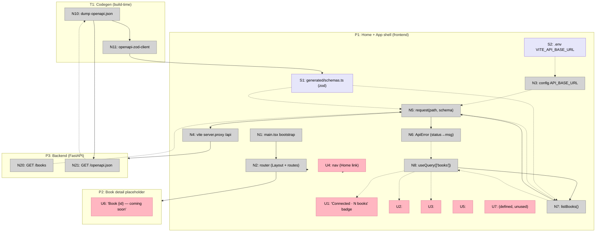

# Step 8 Breadboard — Frontend Foundation (Shape A)

Details the **selected Shape A** from [shaping.md](./shaping.md) into concrete
affordances + wiring. Designed from the shaped parts A1–A9; the backend
(`/books`, `/openapi.json`) is the existing system the new pieces connect to.

Mechanism IDs (A1–A9) reference Shape A in `shaping.md`.

## Places

| # | Place | Description |
|---|-------|-------------|
| P1 | Home + App shell (frontend) | `/` — `<Layout>` chrome (nav + `<Outlet/>`) wrapping the **connectivity-smoke** badge. The demo place |
| P2 | Book detail placeholder (frontend) | `/books/:id` — registered placeholder route, real screen is Steps 10+ |
| P3 | Backend (FastAPI) | Existing. `GET /books` (smoke data) + `GET /openapi.json` (codegen source) |
| T1 | Codegen (build-time trigger) | Not a runtime place — `make openapi` / yarn `gen:api` regenerates the zod schemas from `/openapi.json` |

`<Layout>` is shared chrome around both P1 and P2; nav lives in P1's table.

## UI Affordances

| # | Place | Component | Affordance | Control | Wires Out | Returns To |
|---|-------|-----------|------------|---------|-----------|------------|
| U1 | P1 | Home | "Connected · N books" badge | render | — | — |
| U2 | P1 | `<Loading/>` (shared) | loading skeleton/spinner | render | — | — |
| U3 | P1 | `<ErrorState detail/>` (shared) | friendly error message | render | — | — |
| U4 | P1 | `<Layout>` | header/nav (app title + Home link) | click | → P1 | — |
| U5 | P1 | `<Layout>` | `<Outlet/>` (renders active route) | render | — | — |
| U6 | P2 | BookDetail | placeholder "Book {id} — coming soon" | render | — | — |
| U7 | P1 | `<Empty/>` (shared) | empty primitive — defined (R4.2), unused by the smoke | render | — | — |

## Code Affordances

| # | Place | Component | Affordance | Control | Wires Out | Returns To |
|---|-------|-----------|------------|---------|-----------|------------|
| N1 | P1 | `src/main.tsx` (A1, A6) | bootstrap: mount `QueryClientProvider` + `RouterProvider` | call | → N2 | — |
| N2 | P1 | `src/router.tsx` (A1) | `createBrowserRouter` — `<Layout>` + routes `/`, `/books/:id` | call | → P1, → P2 | — |
| N3 | P1 | `src/config.ts` (A2) | `API_BASE_URL = import.meta.env.VITE_API_BASE_URL` (default `/api`) | config | — | → N5 |
| N4 | P1 | `vite.config.ts` (A2) | `server.proxy` `/api` → `http://localhost:8000` (`rewrite` strips `/api`) | call | → P3 | — |
| N5 | P1 | `src/api/client.ts` (A4) | `request<T>(path, schema, init)` — prefix base URL, JSON, 2xx→`schema.parse`, non-2xx→throw | call | → N4, → N6 | → N7 |
| N6 | P1 | `src/api/client.ts` (A4) | `ApiError {status, detail, message}` — `{detail}` + status→message map | call | — | → N8 |
| N7 | P1 | `src/api/books.ts` (A5) | `listBooks()` → `request('/books', BooksListSchema)` | call | → N5 | → N8 |
| N8 | P1 | Home (A6) | `useQuery(['books'], listBooks)` | observe | → N7 | → U1, → U2, → U3 |
| N10 | T1 | `Makefile` / `gen:api` (A3) | dump `openapi.json` via `app.openapi()` | call | → N21, → N11 | — |
| N11 | T1 | `openapi-zod-client` (A3) | generate schemas-only zod | call | → S1 | — |
| N20 | P3 | `api/routers/books.py` | `GET /books` → `{items: BookOut[]}` | call | — | → N5 |
| N21 | P3 | `api/main.py` | `GET /openapi.json` (`app.openapi()`) | call | — | → N10 |

## Data Stores

| # | Place | Store | Description | Written by | Read by |
|---|-------|-------|-------------|------------|---------|
| S1 | P1 | `src/api/generated/schemas.ts` (A3) | generated zod schemas (`Status`, `BookOut`, `ChunkBase`, `Citation`, `SearchHit`, `AskResponse`, `BooksListSchema`) + `z.infer` types | N11 (codegen) | N5 (parse), N7 (schema arg) |
| S2 | P1 | `frontend/.env` `VITE_API_BASE_URL` (A2) | env base URL (external store, default `/api`) | dev/ops | N3 |

## Wiring notes

- **Smoke (runtime):** P1 mounts → `N8` runs `listBooks` (`N7`) → `request` (`N5`)
  prefixes `API_BASE_URL` (`N3`←`S2`), fetches through the dev proxy (`N4`) →
  backend `GET /books` (`N20`) → JSON returns to `N5` → `N5` parses with the
  generated `BooksListSchema` (`S1`). Success → `BookOut[]` flows `N7`→`N8`→**U1**
  ("Connected · N books"). `N8.isLoading`→**U2**; non-2xx **or** zod parse
  mismatch → `N5` throws `ApiError` (`N6`) → `N8.error`→**U3**.
- **Codegen (build-time):** `N10` reads backend `/openapi.json` (`N21`) → runs
  `openapi-zod-client` (`N11`) → writes `S1`. Decoupled from the runtime path; S1
  is committed (F3) so drift shows as a diff.
- **Origin:** `N4` (Vite proxy) is the only dev bridge to P3 — no CORS, backend
  untouched (D8). In prod the same `/api` path is served by a reverse proxy
  (out of scope).

## Diagram

## Slicing

Step 8 is **one vertical slice** (per `shaping.md` Next Step): the whole skeleton
ships together, demoed by the connectivity smoke — there's no smaller demo-able
increment (a client with no shell, or a shell with no client, demos nothing).

| # | Slice | Mechanism | Affordances | Demo |
|---|-------|-----------|-------------|------|
| V1 | Connectivity smoke | A1–A9 | all (U1–U7, N1–N11, N20–N21, S1–S2) | `yarn dev` + `uvicorn` → `/` shows "Connected · N books"; stop backend → error state; all via typed client + generated zod |

## Next Step

Write [slices.md](./slices.md) formalizing the single V1 slice (affordance table
+ demo + "done when"), then [V1-plan.md](./V1-plan.md) with concrete file diffs
(`frontend/` scaffold, `vite.config.ts` proxy, `config.ts`, `api/client.ts` +
`ApiError`, `api/books.ts`, the `gen:api` codegen wiring, `main.tsx`/`router.tsx`,
shared primitives, `Home.tsx` smoke, `Makefile dev`, `.gitignore`).
