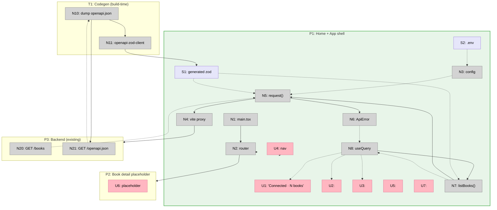

# Step 8 Slices — Vertical Implementation Increments

Slices the breadboard from [breadboard.md](./breadboard.md) into demo-able
vertical increments. Affordance IDs (U1, N5, S1, …) reference
[breadboard.md](./breadboard.md); mechanism IDs (A1–A9) reference Shape A in
[shaping.md](./shaping.md).

Step 8 is one app skeleton proven by a connectivity smoke, so it collapses to a
**single vertical slice**. There's no smaller demo-able increment: a client with
no shell renders nothing; a shell with no client demos nothing. The skeleton is
the unit.

## Slice Summary

| #  | Slice               | Mechanism (Shape A) | Entry point        | Observable output                                                                                                                            |
|----|---------------------|---------------------|--------------------|---------------------------------------------------------------------------------------------------------------------------------------------|
| V1 | Connectivity smoke  | A1–A9               | `yarn dev` → `/`   | Browser at `/` shows **"Connected · N books"** sourced from `GET /books` through the typed client + generated zod; stop the backend → friendly error state; the shell/nav renders and `/books/:id` is a registered placeholder |

One slice. Delivers all of Shape A.

---

## V1 — Connectivity smoke

**Mechanism:** A1 (scaffold + shell) + A2 (env + Vite proxy) + A3 (OpenAPI→zod
codegen) + A4 (typed client + `ApiError`) + A5 (`listBooks`) + A6 (TanStack Query)
+ A7 (smoke route) + A8 (shared primitives) + A9 (repo wiring).

**Entry point:** `yarn dev` (+ `uvicorn` on `:8000`) → open `/`.

**Demo:**

> `make api` (uvicorn `:8000`) and `cd frontend && yarn dev` (Vite `:5173`).
>
> Open `http://localhost:5173/` → a green dot + **"Connected · N books"**, where
> N is the live count from `GET /books` — the request crosses the Vite proxy
> (`/api/books` → `:8000/books`), is parsed by the **generated** zod `BookList`
> schema, and rendered via TanStack Query.
>
> Stop `uvicorn` and reload → the **error state** renders a friendly message
> (`ApiError`), not a crash.
>
> Click the nav title → stays on `/`; visit `/books/:id` by URL → the
> **placeholder** ("Book {id} — coming soon") renders inside the same shell.
>
> Run `make openapi` → regenerates `src/api/generated/schemas.ts` from the
> backend's `/openapi.json`; a contract change shows up as a diff in that file.

### Affordances introduced in V1

| #   | Place | Component                | Affordance                                                       | Control | Wires Out          | Returns To       |
|-----|-------|--------------------------|-----------------------------------------------------------------|---------|--------------------|------------------|
| U1  | P1    | Home                     | "Connected · N books" badge                                     | render  | —                  | —                |
| U2  | P1    | `<Loading/>`             | loading skeleton                                                | render  | —                  | —                |
| U3  | P1    | `<ErrorState/>`          | friendly error message                                          | render  | —                  | —                |
| U4  | P1    | `<Layout>`               | header/nav (Home link)                                          | click   | → P1               | —                |
| U5  | P1    | `<Layout>`               | `<Outlet/>`                                                     | render  | —                  | —                |
| U6  | P2    | BookDetail               | placeholder "Book {id} — coming soon"                          | render  | —                  | —                |
| U7  | P1    | `<Empty/>`               | empty primitive (defined, unused by smoke)                     | render  | —                  | —                |
| N1  | P1    | `src/main.tsx`           | bootstrap `QueryClientProvider` + `RouterProvider`             | call    | → N2               | —                |
| N2  | P1    | `src/router.tsx`         | `createBrowserRouter` (Layout + `/`, `/books/:id`)            | call    | → P1, → P2         | —                |
| N3  | P1    | `src/config.ts`          | `API_BASE_URL` from `import.meta.env`                          | config  | —                  | → N5             |
| N4  | P1    | `vite.config.ts`         | `server.proxy` `/api` → `:8000` (strip prefix)               | call    | → P3               | —                |
| N5  | P1    | `src/api/client.ts`      | `request<T>(path, schema, init)`                              | call    | → N4, → N6         | → N7             |
| N6  | P1    | `src/api/client.ts`      | `ApiError {status, detail, message}`                          | call    | —                  | → N8             |
| N7  | P1    | `src/api/books.ts`       | `listBooks()`                                                 | call    | → N5               | → N8             |
| N8  | P1    | Home                     | `useQuery(['books'], listBooks)`                             | observe | → N7               | → U1, → U2, → U3 |
| N10 | T1    | `Makefile` / `gen:api`   | dump `openapi.json` (`app.openapi()`)                        | call    | → N21, → N11       | —                |
| N11 | T1    | `openapi-zod-client`     | generate schemas-only zod                                    | call    | → S1               | —                |
| S1  | P1    | `src/api/generated/schemas.ts` | generated zod (`BookList`/`BookOut`/`Citation`/…)       | write   | —                  | → N5, → N7       |
| S2  | P1    | `frontend/.env`          | `VITE_API_BASE_URL`                                          | write   | —                  | → N3             |

Reused unchanged (existing system): N20 `GET /books`, N21 `GET /openapi.json`
(backend, Step 1–7).

### Files touched in V1

| File                               | Action                                                                 |
|------------------------------------|------------------------------------------------------------------------|
| `frontend/` (scaffold)             | Create — `yarn create vite . --template react-ts`; add Tailwind, react-router, TanStack Query, zod, openapi-zod-client (A1) |
| `frontend/vite.config.ts`          | `@vitejs/plugin-react` + `server.proxy` `/api` → `:8000` strip (A2/N4) |
| `frontend/.env.example`            | `VITE_API_BASE_URL=/api` (A2/S2)                                        |
| `frontend/src/config.ts`           | `API_BASE_URL` reader (A2/N3)                                           |
| `frontend/src/api/client.ts`       | `request<T>` + `ApiError` (A4/N5, N6)                                   |
| `frontend/src/api/books.ts`        | `listBooks()` (A5/N7)                                                   |
| `frontend/src/api/generated/schemas.ts` | Generated (A3/S1) — committed (F3)                                |
| `frontend/schemas-only.hbs`        | openapi-zod-client template — schemas-only, no Zodios (A3)              |
| `frontend/src/main.tsx`            | Bootstrap providers (A6/N1)                                             |
| `frontend/src/router.tsx`          | Routes (A1/N2)                                                          |
| `frontend/src/components/Layout.tsx` | Shell + nav + `<Outlet/>` (A1/U4, U5)                                 |
| `frontend/src/components/{Loading,ErrorState,Empty}.tsx` | Shared primitives (A8/U2, U3, U7)                  |
| `frontend/src/routes/Home.tsx`     | Smoke (A7/U1, N8)                                                       |
| `frontend/src/routes/BookDetail.tsx` | Placeholder (A1/U6)                                                   |
| `Makefile`                         | `openapi` (dump + `gen:api`), `web` targets (A9/N10)                    |
| `.gitignore`                       | Ignore `frontend/node_modules`, `frontend/dist`, `frontend/openapi.json`; un-ignore `frontend/.env.example` (A9) |

### Done when

- `yarn dev` + `uvicorn`: `/` renders **"Connected · N books"** with the live
  count, sourced through `request` → Vite proxy → `GET /books` → generated-zod
  parse → TanStack Query
- Backend down (or non-2xx) → the **error state** renders `ApiError.message`
  (friendly), no white screen / unhandled rejection
- A zod parse mismatch (e.g. backend shape drift) surfaces as the same error
  state, not a silent `any`
- The Vite proxy is the only path to the backend (no CORS added to the backend);
  `VITE_API_BASE_URL=/api`
- `/books/:id` renders the placeholder inside the shared shell; nav renders
- `make openapi` regenerates `src/api/generated/schemas.ts` from a dumped
  `openapi.json` with **no running server** (the dump is offline via
  `app.openapi()`); the file is committed
- `yarn build` (`tsc -b && vite build`) is green — types resolve, generated zod
  imports cleanly, no axios/Zodios dep pulled in

### Not yet in V1 (Step 9+)

- No Library grid / status badges (Step 9), Ask (10), Sources/chunks (11),
  Upload (12), polling hook (13), Delete (14)
- No per-endpoint client fns beyond `listBooks` — added in their steps
- No `impeccable` polish pass (structural step)
- No prod reverse-proxy / static-deploy tooling (decided in D8, built at deploy)

## Slice Diagram

## Coverage Check

Every Shape A part is delivered by V1:

| A part | Slice | Affordance |
|--------|-------|------------|
| A1 (scaffold + shell)        | V1 | N1, N2, U4, U5, U6 |
| A2 (env + Vite proxy)        | V1 | N3, N4, S2 |
| A3 (OpenAPI→zod codegen)     | V1 | N10, N11, S1 |
| A4 (typed client + ApiError) | V1 | N5, N6 |
| A5 (`listBooks`)             | V1 | N7 |
| A6 (TanStack Query)          | V1 | N1, N8 |
| A7 (smoke route)             | V1 | U1, N8 |
| A8 (shared primitives)       | V1 | U2, U3, U7 |
| A9 (repo wiring)             | V1 | Makefile/.gitignore |

## Next Step

Write [V1-plan.md](./V1-plan.md) with concrete file contents — the `frontend/`
scaffold, `vite.config.ts` proxy, `config.ts`, `api/client.ts` + `ApiError`,
`api/books.ts`, the schemas-only codegen template + `gen:api`/`make openapi`
wiring, `main.tsx`/`router.tsx`, shared primitives, `Home.tsx` smoke,
`BookDetail.tsx` placeholder, and the `Makefile` + `.gitignore` edits.
