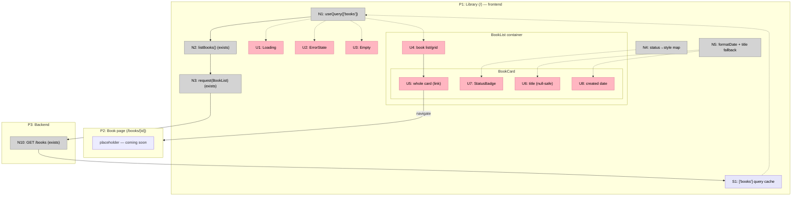

# Step 9: Library — Breadboard (Shape A)

Detailing Shape A (`docs/v1/step9/shaping.md`) into concrete affordances. The
data path (TanStack Query → `listBooks()` → `request<T>` → `BookList` zod) and
the loading/error/empty primitives **already exist** from Step 8 — they appear
here as existing affordances the new presentational pieces wire into. New
affordances: `<BookCard/>`, `<StatusBadge/>`, the `formatDate`/title-fallback
helper, and the list container that replaces the smoke render in `app/page.tsx`.

## Places

| # | Place | Description |
|---|-------|-------------|
| P1 | Library (`/`) — frontend | `app/page.tsx`, the Library screen (was the Step 8 smoke) |
| P2 | Book page (`/books/[id]`) — frontend | Existing placeholder route; the card's navigation target |
| P3 | Backend | FastAPI `GET /books` |

## UI Affordances

| # | Place | Component | Affordance | Control | Wires Out | Returns To |
|---|-------|-----------|------------|---------|-----------|------------|
| U1 | P1 | `app/page.tsx` | `<Loading/>` (connecting) | render | — | — |
| U2 | P1 | `app/page.tsx` | `<ErrorState detail/>` | render | — | — |
| U3 | P1 | `app/page.tsx` | `<Empty label="No books yet."/>` | render | — | — |
| U4 | P1 | `BookList` container | book list/grid (newest-first) | render | → U5 | — |
| U5 | P1 | `BookCard` | whole card (`next/link`) | click | → P2 | — |
| U6 | P1 | `BookCard` | title (null-safe) | render | — | — |
| U7 | P1 | `StatusBadge` | status badge (4 states) | render | — | — |
| U8 | P1 | `BookCard` | created date | render | — | — |

## Code Affordances

| # | Place | Component | Affordance | Control | Wires Out | Returns To |
|---|-------|-----------|------------|---------|-----------|------------|
| N1 | P1 | `app/page.tsx` | `useQuery(['books'], listBooks)` | observe | → N2 | → U1, U2, U3, U4 |
| N2 | P1 | `api/books.ts` | `listBooks()` *(exists)* | call | → N3 | → N1 |
| N3 | P1 | `api/client.ts` | `request('/books', BookList)` *(exists)* | call | → N10 | → N2 |
| N4 | P1 | `StatusBadge` | status→style/label map | call | — | → U7 |
| N5 | P1 | `lib/format` | `formatDate()` + title fallback | call | — | → U6, U8 |
| N10 | P3 | books router | `GET /books` → `{items: BookOut[]}` *(exists)* | call | → S1 | → N3 |

## Data Stores

| # | Place | Store | Description |
|---|-------|-------|-------------|
| S1 | P1 | `['books']` query cache | TanStack Query cache for the book list; feeds the render. Refetch on mount/focus (D3), no polling |

## Wiring diagram

**Notes:**
- N2/N3/N10 and U1/U2/U3 (the primitives) are **existing** from Step 8 — Step 9
  reuses them; the render swap in `app/page.tsx` (N1's consumers) is the change.
- U5 wires to the **Place** P2 (navigation), not an affordance inside it — the
  book page is a placeholder until Step 10/11.
- No write path, no mutation, no polling: Library is read-only this step (D3,
  R6.x).
