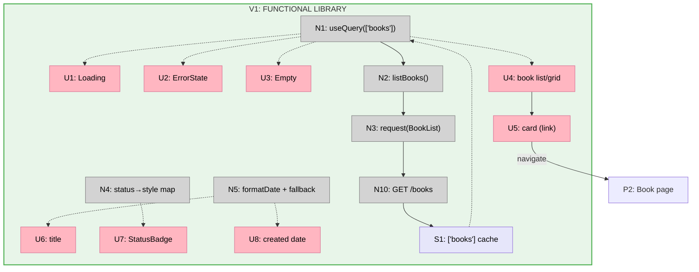

# Step 9: Library — Slices (Shape A)

Slicing the Step 9 breadboard (`docs/v1/step9/breadboard.md`) into vertical
increments. The functional Library is one cohesive demo (the data fetch + cards
already share one render path), so the split is **function then polish**: V1
ships the working Library; V2 is the `impeccable` pass (R5.1/D5) — the step's
closing move, kept separate because its demo is a distinct before/after.

## Slice Summary

| # | Slice | Mechanism (shape parts) | Affordances | Demo |
|---|-------|--------------------------|-------------|------|
| V1 | Functional Library | A1–A5 | U1–U8, N1–N5, N10, S1 | Seed 3 books via API → load `/` → newest-first cards (title, badge, date) render; click a card → `/books/{id}`; with zero books → "No books yet"; backend down → error |
| V2 | `impeccable` pass | A6 | (restyles U3–U8) | Before/after: hierarchy, card + badge styling, spacing, responsive grid/list, polished empty state |

Max 9 slices; 2 used.

## V1: Functional Library

Replaces the `app/page.tsx` smoke render with the Library. Reuses the existing
data path (N2/N3/N10) and primitives (U1/U2/U3) unchanged; adds the list
container, `<BookCard/>`, `<StatusBadge/>`, and the `formatDate`/title-fallback
helper.

| # | Place | Component | Affordance | Control | Wires Out | Returns To |
|---|-------|-----------|------------|---------|-----------|------------|
| U1 | P1 | `app/page.tsx` | `<Loading/>` *(exists)* | render | — | — |
| U2 | P1 | `app/page.tsx` | `<ErrorState/>` *(exists)* | render | — | — |
| U3 | P1 | `app/page.tsx` | `<Empty label="No books yet."/>` *(exists)* | render | — | — |
| U4 | P1 | `BookList` | book list/grid (newest-first) | render | → U5 | — |
| U5 | P1 | `BookCard` | whole card (`next/link`) | click | → P2 | — |
| U6 | P1 | `BookCard` | title (null-safe) | render | — | — |
| U7 | P1 | `StatusBadge` | status badge (4 states) | render | — | — |
| U8 | P1 | `BookCard` | created date | render | — | — |
| N1 | P1 | `app/page.tsx` | `useQuery(['books'], listBooks)` | observe | → N2 | → U1, U2, U3, U4 |
| N2 | P1 | `api/books.ts` | `listBooks()` *(exists)* | call | → N3 | → N1 |
| N3 | P1 | `api/client.ts` | `request('/books', BookList)` *(exists)* | call | → N10 | → N2 |
| N4 | P1 | `StatusBadge` | status→style/label map | call | — | → U7 |
| N5 | P1 | `lib/format` | `formatDate()` + title fallback | call | — | → U6, U8 |
| N10 | P3 | books router | `GET /books` *(exists)* | call | → S1 | → N3 |
| S1 | P1 | — | `['books']` query cache | store | — | → N1 |

**Demo:** `make db-up && make db-migrate && make api-dev`; seed 2–3 books via
`POST /books/upload` (various statuses — at least one `ready`, ideally one
`pending`/`failed`); `make web`; open `/` → cards render newest-first with title,
status badge, and date; click a card → navigates to `/books/{id}` placeholder;
delete all books (or point at an empty DB) → "No books yet"; stop the API →
error state.

## V2: `impeccable` pass

No new affordances — restyles V1's UI (U3–U8) and layout. The polish pass:
visual hierarchy, `<BookCard/>` + `<StatusBadge/>` styling (the 4 states legibly
distinct, `processing` with a subtle spinner per `frontend_mvp.md`), spacing,
responsive grid-on-wide / stacked-on-narrow, and the empty state.

**Demo:** before/after of the Library at desktop and narrow widths.

## Slice diagram

V2 adds no nodes — it restyles V1's U3–U8, so the slice diagram is V1's graph.

## Next Step

Write `V1-plan.md` (the functional Library implementation plan). V2's `impeccable`
pass is a styling cycle on top of V1 and gets its plan when V1 lands.
